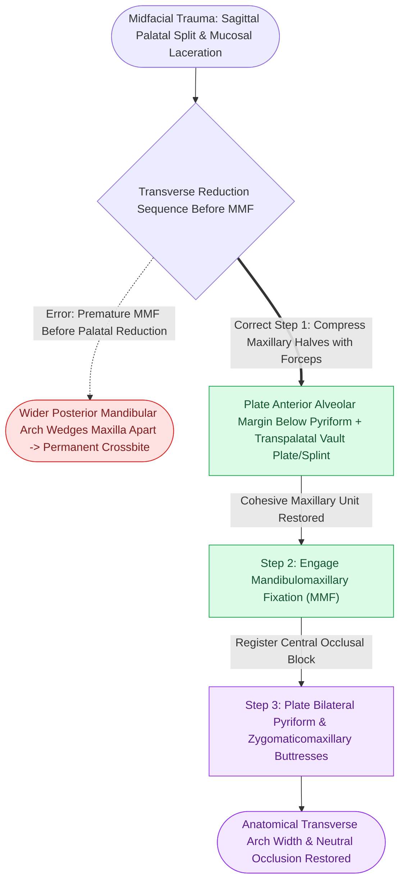

# Sagittal palatal split fractures require transpalatal reduction prior to mandibulomaxillary fixation to prevent arch widening

## Active Recall

> [!question]- Why does applying mandibulomaxillary fixation (MMF) before reducing an unrecognized sagittal palatal fracture cause a severe post-traumatic malocclusion?
> *Answer / Clinical Rationale*: In a sagittal palatal fracture, the maxilla is split longitudinally into two independent hemipalates. If MMF is applied without first reducing and rigidly locking the palate, the upward force of the intact mandibular dental arch drives the hemipalates superiorly and flares the maxillary molars laterally. The palatal halves rotate or telescope outward around a sagittal hinge axis, locking the patient into an **expanded maxillary transverse dimension, bilateral crossbite, and premature palatal cusp contact**.

> [!question]- What is the definitive operative sequence for stabilizing a Le Fort I fracture associated with a sagittal palatal fracture?
> *Answer / Clinical Rationale*: (1) Expose the maxillary gingivobuccal sulcus and anterior hard palate. (2) Manually reduce the palatal halves and stabilize them with an **anterior alveolar cross-plate** ($1.5\text{ mm}$ or $2.0\text{ mm}$) placed horizontally below the anterior nasal spine across the midline split, combined with an acrylic palatal splint or transpalatal wire if posterior comminution exists. (3) Engage **MMF** to register the reconstructed single-piece maxillary arch to the intact mandibular occlusion. (4) Reconstruct the vertical midface pillars by plating bilateral pyriform apertures and bilateral zygomaticomaxillary buttresses.

## Core Clinical & Mechanistic Principles

Fractures of the hard palate occur in **$8\text{--}15\%$** of all midfacial injuries and are most commonly associated with [[Le Fort I fractures separate the hard palate and require bilateral buttress plate fixation|Le Fort I and II patterns]] resulting from high-energy blunt trauma. The palate can be divided into sagittal (midline), parasagittal (para-alveolar), and transverse fracture subtypes.

The clinical pitfall in palatal trauma lies in the mechanical assumption that placing the teeth into occlusion automatically reduces the palate. In reality, the mandibular arch is wider posteriorly than the natural maxillary arch; closing the jaws against a fractured palate wedges the two halves apart.

### Key Surgical Rules for Palatal Reduction:
1. **Clinical Indicators**: Look for longitudinal lacerations of the palatal mucosa, ecchymosis along the midpalatal raphe, stepped occlusal planes between the central incisors, or splaying of the maxillary tuberosities upon manual palpation.
2. **Prioritization Before MMF**: The palate must be transformed into a **single cohesive rigid unit** before locking into intermaxillary fixation. An unreduced palate entered into MMF guarantees a widened maxillary arch and permanent crossbite.
3. **Rigid Transverse Plating**: Apply a heavy miniplate ($1.5\text{ mm}$ or $2.0\text{ mm}$) across the labial alveolar bone directly beneath the anterior nasal spine. If posterior splay persists, an acrylic palatal splint wired to molar teeth or a direct transpalatal plate placed via a palatal split incision neutralizes rotational torque.

## Connected Concepts & Graph Traversal
- **Maxillary Buttress Continuity**: [[Le Fort I fractures separate the hard palate and require bilateral buttress plate fixation|Le Fort I Maxillary Buttress Fixation]]
- **🔗 Panfacial Sequencing Ladder (FPRS)**: [[Panfacial fracture reconstruction proceeds from known stable peripheral buttresses to central occlusion|Panfacial Occlusal Anchoring]]
- **🔗 Orbital Rim Coordination (FPRS)**: [[Zygomaticomaxillary complex fractures disrupt four buttress articulations requiring multi-point reduction|ZMC Multi-Point Rigid Fixation]]
- **🔗 Mandibular Occlusal Opponent (FPRS)**: [[Mandible fractures require anatomical reduction and load-sharing miniplate fixation along Champy lines of ideal osteosynthesis|Mandibular Tension Band & Load-Sharing]]
- **Bone Healing Ground Truth**: [[Primary contact bone healing requires absolute stability with interfragmentary strain under two percent|Primary Contact Bone Healing Threshold]]
