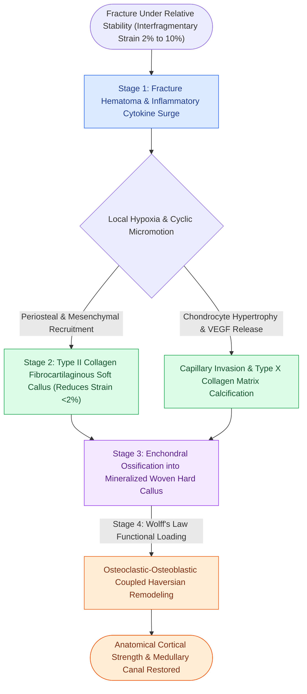

# Secondary indirect bone healing proceeds through an enchondral cartilaginous callus under relative stability

## Active Recall

> [!question]- What are the four consecutive biological stages of secondary indirect bone healing, and what mechanical conditions trigger this cascade?
> *Answer / Clinical Rationale*: Secondary bone healing is triggered by **relative stability** where interfragmentary strain ranges between **2% and 10%** with micro-motion. The cascade proceeds through four stages: (1) **Fracture Hematoma & Inflammation** (cytokines IL-1, IL-6, TNF-alpha recruit mesenchymal stem cells); (2) **Fibrocartilaginous Soft Callus Formation** (chondrogenesis stabilizes initial motion); (3) **Hard Bony Callus Deposition** (enchondral ossification converts cartilage to woven bone, visible on radiography); and (4) **Secondary Haversian Remodeling** (osteoclasts and osteoblasts re-establish lamellar architecture along lines of mechanical stress per Wolff's law).

> [!question]- Why does secondary bone healing rarely occur in facial skeleton fractures treated with modern surgical technique?
> *Answer / Clinical Rationale*: In craniomaxillofacial surgery, secondary healing is deliberately avoided because callus formation produces bony widening, contour irregularities, and unpredictable fragment shifting that disrupts delicate dental occlusion. Rigid internal fixation clamps interfragmentary strain below 2%, bypassing callus formation to achieve direct primary contact or gap healing. Secondary healing is seen primarily in conservative non-surgical management of pediatric fractures or condylar neck fractures managed with closed functional therapy.

## Core Clinical & Mechanistic Principles

Unlike long-bone orthopedics where casting or intramedullary nailing permits controlled cyclic micromotion to stimulate robust external callus, craniomaxillofacial surgery generally demands [[Primary contact bone healing requires absolute stability with interfragmentary strain under two percent|primary contact bone healing]] to preserve facial symmetry and occlusal alignment. However, when fractures are managed with load-sharing splints, closed reduction, or in the growing pediatric skeleton, bone consolidation proceeds via **secondary indirect healing**.

The biological hallmark of secondary healing is the **enchondral transition**:
1. Mesenchymal progenitor cells in the periosteum and surrounding soft tissues differentiate into chondrocytes under low oxygen tension and cyclic shear forces.
2. Chondrocytes synthesize a type II collagen and proteoglycan extracellular matrix forming the soft callus, bridging the fracture gap and reducing interfragmentary strain.
3. Chondrocytes undergo hypertrophy, express VEGF to recruit capillary invasion, and deposit type X collagen which calcifies.
4. Osteoblasts invade along neovascular channels, depositing woven bone that is subsequently remodeled into mature lamellar bone by Haversian cutting cones.

## Connected Concepts & Graph Traversal
- **Rigid Frame Technology**: [[Locking internal fixator plates preserve periosteal microvascular perfusion without frictional bone compression|Locking Internal Fixator Technology]]
- **Compression Mechanics**: [[The lag screw principle generates interfragmentary compression by engaging solely the distal cortex|The Lag Screw Principle]]
- **Condylar Functional Remodeling**: [[Pediatric mandibular condyle fractures are managed with short-term functional mobilization to exploit biological remodeling and prevent ankylosis|Pediatric Condylar Secondary Remodeling]]
- **🔗 Condylar Remodeling Dynamics (FPRS)**: [[Mandibular condyle fractures managed via open versus closed reduction depend on displacement and occlusion|Condylar Fracture Management]]
- **Perren Strain Mechanics**: [[Perren strain theory dictates tissue differentiation and mechanical thresholds for osteogenesis|Perren Strain Theory (2-10% Strain)]]
