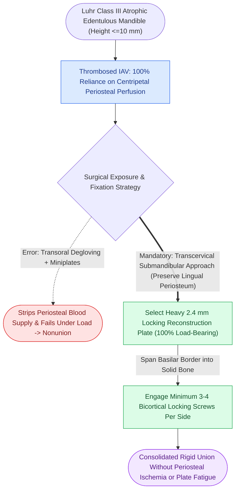

# Severely atrophic edentulous mandible fractures classified by Luhr mandate load-bearing reconstruction plate fixation

## Active Recall

> [!question]- What are the criteria of the Luhr classification for atrophic edentulous mandible fractures, and why does Luhr Class III mandate load-bearing hardware?
> *Answer / Clinical Rationale*: The Luhr classification categorizes the atrophic mandible based on bone height measured at the thinnest vertical cross-section: **Class I** ($16\text{--}20\text{ mm}$, mild atrophy); **Class II** ($11\text{--}15\text{ mm}$, moderate atrophy); and **Class III** ($\le 10\text{ mm}$, severe "pencil-thin" atrophy). In Class III, cross-sectional bony contact is so minuscule that fragments cannot share functional compressive loads (load-sharing is biomechanically impossible); hardware must be **100% load-bearing**, using a $2.4\text{ mm}$ or $2.7\text{ mm}$ reconstruction plate with $\ge 3\text{--}4$ bicortical locking screws per fragment.

> [!question]- Why do monocortical miniplates applied along the alveolar border routinely fail in an edentulous Luhr Class III mandible?
> *Answer / Clinical Rationale*: In a dentate mandible, functional tension concentrates at the alveolar border. In a severely resorbed edentulous mandible, the entire alveolar process has disappeared down to basal bone; the biomechanical neutral axis shifts, eliminating the tension/compression differential. Furthermore, endosteal blood supply from the inferior alveolar artery is typically obliterated by senile arteriosclerosis, leaving bone entirely dependent on fragile periosteal perfusion. Miniplates lack the section modulus to withstand masticatory bending without bone contact, causing early fatigue fracture and screw pull-out.

## Core Clinical & Mechanistic Principles

Fractures of the atrophic edentulous mandible represent one of the most challenging entities in craniomaxillofacial trauma. Tooth loss initiates progressive, irreversible resorption of the alveolar ridge, reducing the mandible to a pencil-thin basilar rim with bone height $\le 10\text{ mm}$ (Luhr Class III). Unlike healthy dentate patients where [[Mandible fractures require anatomical reduction and load-sharing miniplate fixation along Champy lines of ideal osteosynthesis|Champy tension band miniplates]] achieve stable load-sharing, the atrophic mandible cannot share mechanical loads.

The biological and mechanical realities dictate rigid operative protocols:
1. **Centripetal Periosteal Vascular Reliance**: In the elderly edentulous mandible, the inferior alveolar artery is frequently thrombosed. Cortical bone survives almost exclusively on centripetal blood supply from the attached periosteum and musculature (digastric, geniohyoid, mylohyoid). Transoral approaches require extensive degloving that strips this tenuous blood supply; therefore, a **transcervical (submandibular) approach** is preferred to expose the lateral and inferior border while leaving lingual soft tissues strictly attached.
2. **Mandate for Load-Bearing Osteosynthesis**: Because the fracture surfaces have negligible cross-sectional area, the bone fragments cannot absorb compressive forces. The hardware must assume **100% of all functional masticatory loads**.
3. **Hardware Specifications**: A heavy $2.4\text{ mm}$ or $2.7\text{ mm}$ titanium reconstruction plate with locking screw technology is mandatory. At least **3 to 4 bicortical locking screws** must be placed in solid bone on either side of the fracture line.

Closed reduction with Gunning splints or old dentures wired to the mandible is reserved strictly for non-displaced fractures in medically frail patients who cannot tolerate general anesthesia. For all displaced fractures, load-bearing locking reconstruction plating is the gold standard.

## Connected Concepts & Graph Traversal
- **Bone Healing Biology**: [[Primary contact bone healing requires absolute stability with interfragmentary strain under two percent|Primary Contact Bone Healing Threshold]]
- **Internal Fixator Architecture**: [[Locking internal fixator plates preserve periosteal microvascular perfusion without frictional bone compression|Locking Internal Fixator Technology]]
- **Load-Bearing Biomechanics**: [[Load-bearing fixation supports one hundred percent of functional loads in comminuted or atrophic bone|Load-Bearing Fixation Biomechanics]]
- **Cortical Perfusion Reliance**: [[Centripetal periosteal and centrifugal endosteal blood supplies preserve cortical bone viability|Centripetal Periosteal Perfusion]]
- **🔗 Temporomandibular Joint Dynamics (FPRS)**: [[Mandibular condyle fractures managed via open versus closed reduction depend on displacement and occlusion|Condylar Fracture Management]]
