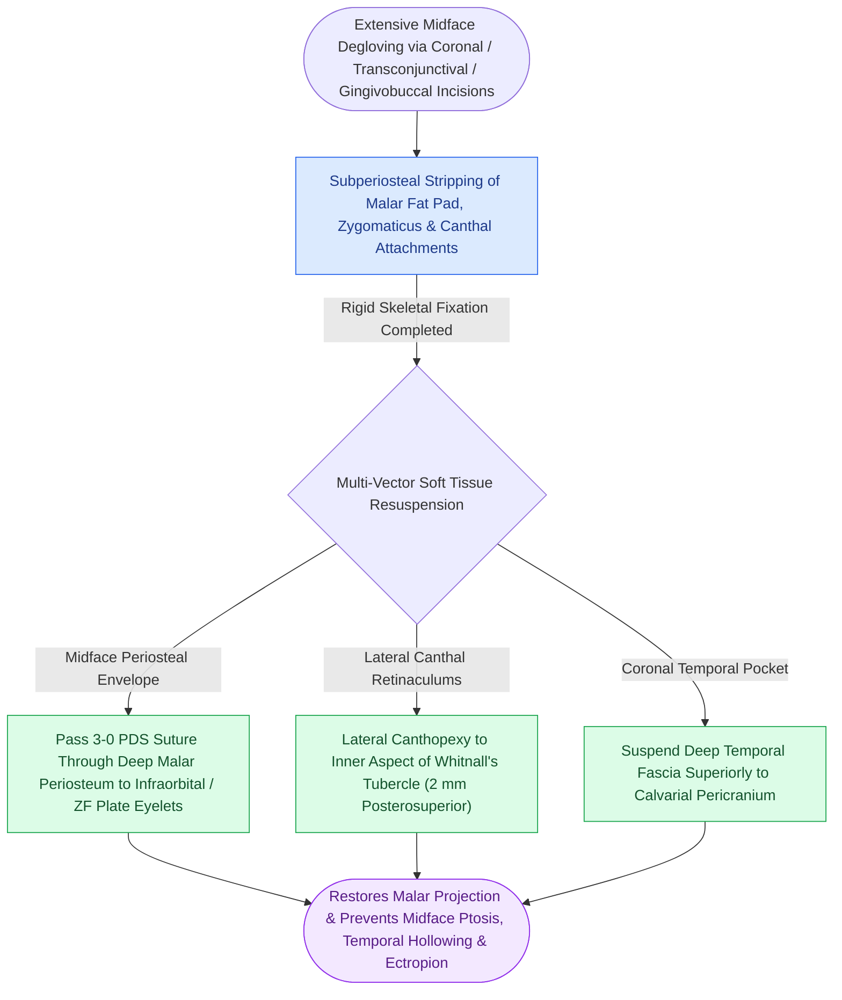

# Soft tissue resuspension to facial bone plates prevents post-traumatic facial drooping and lower eyelid ectropion

## Active Recall

> [!question]- Why does extensive subperiosteal degloving of the midface inevitably cause soft tissue ptosis and lower eyelid scleral show if resuspension is omitted?
> *Answer / Clinical Rationale*: Wide surgical exposure for midfacial and orbital trauma strips the periosteum, masseteric origins, zygomaticus major and minor muscles, and the midfacial superficial musculoaponeurotic system (SMAS) from bone. Once detached, gravity and scar contracture pull the heavy cheek soft tissue envelope downward. This leads to **malar flattening, deepening of the nasolabial fold, rounding of the lateral canthus, inferior lower lid retraction (scleral show), and cicatricial ectropion**.

> [!question]- Describe the surgical technique for periosteal and muscular resuspension to titanium plates or drill holes in the zygomaticomaxillary complex.
> *Answer / Clinical Rationale*: Before wound closure, the stripped midfacial musculature and periosteum are grasped with forceps and suspended in a **superior and slightly posterior vector**. Strong, slowly resorbable or non-resorbable sutures (e.g., 2-0 or 3-0 braided polydioxanone or polypropylene) are passed through the deep periosteum/SMAS and anchored to the **screw holes of the zygomaticofrontal plate, the infraorbital rim plate, or dedicated drill holes** in the bone. In addition, lateral canthopexy and temporal fascia suspension are performed.

## Core Clinical & Mechanistic Principles

Surgical correction of craniomaxillofacial trauma does not end with rigid bone fixation. The facial skeleton serves as the scaffolding for facial mimetic expression, and restoring the [[The facial skeleton absorbs impact forces through vertical and horizontal structural buttresses|skeletal buttress restoration]] must be paired with anatomical repositioning of the soft tissue envelope.

Key surgical tenets:
1. **Canthal Re-attachment**: If the lateral canthal tendon was detached (e.g., during transconjunctival or lateral brow exposures), it must be resuspended to the inner aspect of Whitnall's tubercle ($2\text{ mm}$ posterior and superior to the lateral orbital margin) to keep the lid snug against the globe.
2. **Temporal Fascia Closure**: Deep temporal fascia must be suspended superiorly to the calvarial pericranium during coronal flap closure to prevent hollowing of the temporal fossa and drooping of the lateral brow.
3. **Plating Integration**: Using the empty auxiliary screw holes of low-profile miniplates as suture anchoring eyelets avoids the need for dedicated transosseous drill holes.

## Connected Concepts & Graph Traversal
- **Zygomatic Arch Frame**: [[Anatomical reduction of the zygomatic arch restores lateral facial width and anteroposterior malar projection in panfacial trauma|Zygomatic Arch Reduction]]
- **ZMC Sphenozygomatic Key**: [[The sphenozygomatic suture along the lateral orbital wall serves as the primary key for three-dimensional ZMC reduction|Sphenozygomatic Suture Reduction]]
- **Retrobulbar Emergency Rescue**: [[Acute post-traumatic retrobulbar hematoma with impending vision loss requires bedside lateral canthotomy and inferior cantholysis|Retrobulbar Hematoma Emergency Rescue]]
- **NOE Canthopexy Technique**: [[Type III nasoorbitoethmoidal fractures require transnasal canthopexy directed posterior and superior to the lacrimal crest|Type III NOE Reconstruction]]
- **Titanium Plate Hardware**: [[Commercially pure titanium forms a passivated titanium dioxide layer ensuring biocompatibility|Titanium Plate Anchorage]]
