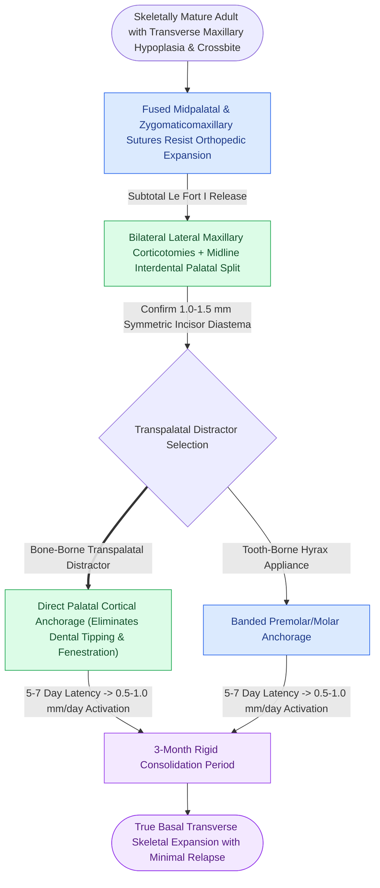

# Surgically assisted rapid palatal expansion combines subtotal Le Fort I osteotomies with midpalatal distraction for transverse maxillary deficiency

## Active Recall

> [!question]- What areas of anatomical skeletal resistance must be released in skeletally mature adults to allow rapid palatal expansion?
> *Answer / Clinical Rationale*: In skeletally mature adolescents and adults (> 15 to 18 years), the midpalatal suture interdigitates tightly, and the craniofacial buttresses resist orthodontic force. Attempting rapid palatal expansion without surgery causes dental tipping, periodontal recession, buccal root dehiscence, and severe pain. SARPE surgically releases the **four primary zones of transverse resistance**: (1) The **midpalatal suture**; (2) The **zygomaticomaxillary buttresses**; (3) The **pyriform aperture lateral nasal margins**; and (4) The **pterygomaxillary junctions** (selective/optional).

> [!question]- Detail the surgical cuts performed during a SARPE procedure and explain the post-activation protocol.
> *Answer / Clinical Rationale*: A subtotal Le Fort I osteotomy is performed: horizontal cuts through the bilateral anterior and lateral maxillary walls, division of the lateral nasal walls, and a **midline osteotomy through the hard palate between the central incisors** from the anterior nasal spine to the posterior border. Pterygoid downfracture is omitted. An expansion appliance (Hyrax or bone-borne distractor) is activated $1\text{ to }2\text{ mm}$ intraoperatively to confirm midline opening. After a **5 to 7 day latency period**, the patient activates the appliance at **0.25 mm twice daily ($0.5\text{ mm/day}$)** until the posterior crossbite is overcorrected, followed by 3 months of consolidation.

## Core Clinical & Mechanistic Principles

Transverse maxillary hypoplasia produces unilateral or bilateral posterior crossbites and severe dental crowding. SARPE harnesses the biological principles of distraction osteogenesis to widen the basal [[Sagittal palatal split fractures require transpalatal reduction prior to mandibulomaxillary fixation to prevent arch widening|transverse maxillary palatal arch]].

Operative tenets:
1. **Central Incisor Root Protection**: The midline interdental osteotomy must be placed strictly parallel to the roots of the central incisors under direct visual or radiographic control to prevent root transection or periodontal ligament devascularization.
2. **Bone-Borne vs Tooth-Borne Distractors**: Bone-borne transpalatal distractors (TPDs) anchor directly into the palatal cortical bone, delivering pure skeletal expansion while eliminating molar tipping and periodontal bone loss associated with tooth-borne appliances.
3. **Midline Diastema**: Patients must be counseled that a prominent space ($5\text{ to }10\text{ mm}$) will open between the central incisors during activation, which is closed during subsequent orthodontic treatment.

## Connected Concepts & Graph Traversal
- **Le Fort I Downfracture**: [[Le Fort I downfracture osteotomy preserves collateral maxillary perfusion via the ascending palatine and ascending pharyngeal arteries|Le Fort I Osteotomy Perfusion]]
- **Bimaxillary Surgery**: [[Two-jaw bimaxillary orthognathic sequencing utilizes intermediate and final occlusal splints to coordinate three-dimensional repositioning|Two-Jaw Bimaxillary Sequencing]]
- **Distraction Biology**: [[Secondary indirect bone healing proceeds through an enchondral cartilaginous callus under relative stability|Distraction Osteogenesis Biology]]
- **Perren Mechanical Thresholds**: [[Perren strain theory dictates tissue differentiation and mechanical thresholds for osteogenesis|Perren Strain Biomechanics]]
- **Buttress System**: [[The facial skeleton absorbs impact forces through vertical and horizontal structural buttresses|Facial Buttress Framework]]
