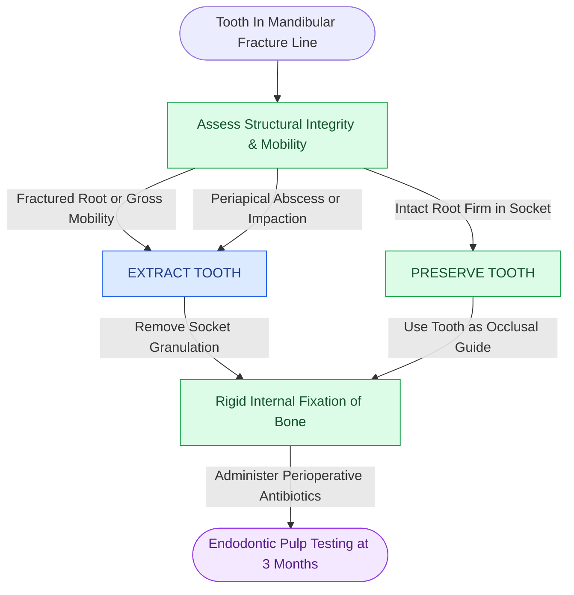

# Teeth in the mandibular fracture line are extracted if roots are fractured or loose but preserved if structurally intact

## Active Recall

> [!question]- What are the strict absolute indications for extracting a tooth involved in a mandibular fracture line?
> *Answer / Clinical Rationale*: A tooth in the fracture line must be extracted if: (1) The **root is fractured or shattered**; (2) The tooth is **luxated, avulsed, or grossly mobile**; (3) Pre-existing **periapical abscess, advanced periodontal disease, or severe pericoronitis** is present; (4) The tooth or root fragment **interferes mechanically with anatomical fracture reduction**; or (5) A partially erupted third molar prevents plate adaptation or sits in an infected angle fracture.

> [!question]- Why has the historic practice of routinely extracting all teeth in fracture lines been abandoned in modern AO surgery?
> *Answer / Clinical Rationale*: Historically, teeth in fracture lines were extracted because non-rigid wire fixation allowed micro-motion, leading to salivary contamination and osteomyelitis. In modern AO surgery with **rigid internal fixation (RIF)**, an intact, stable tooth provides a critical **anatomical key for restoring pre-traumatic occlusion** and assists in vertical load-sharing. If the periodontal membrane and root remain intact and the fracture is rigidly immobilized with perioperative antibiotics, $> 85\text{--}90\%$ of preserved teeth remain vital or can be managed with elective root canal therapy later.

## Core Clinical & Mechanistic Principles

The management of dentition in craniomaxillofacial fractures represents an important intersection between dental occlusion and bone biology. Fractures through the alveolar process communicate directly with the oral cavity via the periodontal ligament, converting closed skeletal trauma into **compound (open) contaminated fractures**. Stable repair must prevent osteomyelitis while preserving functional teeth, maintaining [[Load-sharing fixation relies on anatomically interlocked bone fragments to share compressive masticatory forces|load-sharing interlock]].

Key decision rules:
1. **Third Molars in Angle Fractures**: A non-displaced, fully impacted third molar that does not interfere with fracture reduction or plate placement should be **left in place**; extracting it intraoperatively destroys the superior alveolar tension shelf and leaves a massive bony defect. Conversely, a partially erupted third molar with pericoronal infection should be extracted.
2. **Anterior Dentition**: Anterior incisors and canines should be preserved whenever possible because losing an anterior tooth leads to severe alveolar resorption and aesthetic compromise.
3. **Endodontic Follow-Up**: Preserved teeth frequently exhibit transient pulpal neurapraxia with negative electric pulp testing acutely. True pulpal vitality should be re-evaluated at **3 and 6 months** post-injury before initiating definitive endodontic therapy unless acute apical radiolucency or symptomatic pulpitis develops.

## Connected Concepts & Graph Traversal
- **Symphyseal Plating Craft**: [[Mandibular symphyseal and parasymphyseal fractures require dual-plate fixation to neutralize torsional rotational vectors|Mandibular Symphysis Dual-Plating]]
- **Angle Fracture Management**: [[Mandibular angle fractures with comminution or bone defects mandate load-bearing reconstruction plates|Comminuted Angle Reconstruction Plating]]
- **Tension Band Biomechanics**: [[Mandible fractures require anatomical reduction and load-sharing miniplate fixation along Champy lines of ideal osteosynthesis|Mandibular Tension Band & Load-Sharing]]
- **Occlusal MMF Systems**: [[Mandibulomaxillary fixation with arch bars or cortical screws establishes the central occlusal relationship|Mandibulomaxillary Fixation Principles]]
- **Bone Infection Prevention**: [[Primary contact bone healing requires absolute stability with interfragmentary strain under two percent|Primary Contact Bone Healing Threshold]]
