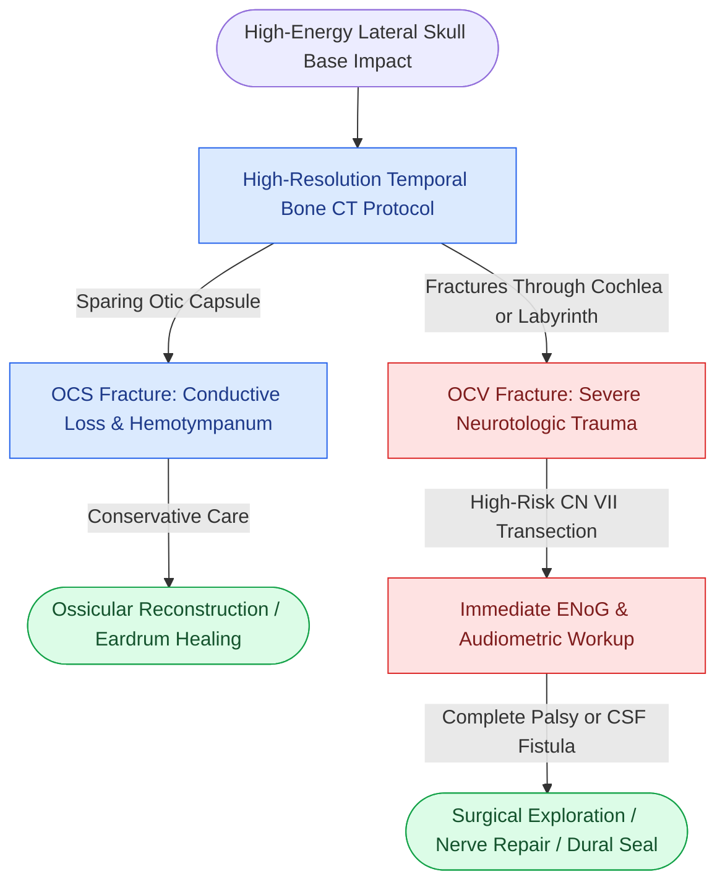

# Temporal bone fractures classified as otic capsule violating carry high risks of sensorineural hearing loss and facial nerve transection

## Active Recall

> [!question]- How does the modern clinical classification of temporal bone fractures (Otic Capsule Violating vs Otic Capsule Sparing) compare to the historic longitudinal/transverse system in predicting patient outcomes?
> *Answer / Clinical Rationale*: The historic classification (longitudinal along petrous axis vs transverse perpendicular to petrous axis) poorly correlates with clinical sequelae. Modern management utilizes the **Otic Capsule Sparing (OCS)** versus **Otic Capsule Violating (OCV)** classification. OCS fractures (80–85%) spare the labyrinthine bone, presenting primarily with conductive hearing loss (tympanic perforation or ossicular disruption). OCV fractures (15–20%) traverse the otic capsule and carry an exponentially higher risk of **permanent profound sensorineural hearing loss (SNHL) (50–60% vs 5%)**, severe vertigo, **facial nerve palsy (30–50% vs 10%)**, and persistent CSF leak.

> [!question]- What are the clinical and audiometric sequelae characteristic of an otic capsule violating (OCV) fracture?
> *Answer / Clinical Rationale*: (1) **Profound dead ear**: Complete, irreversible sensorineural hearing loss from cochlear or internal acoustic canal fracture; (2) **Violent spontaneous vestibular nystagmus**: Fast phase beating toward the contralateral uninjured ear due to acute vestibular deafferentation; (3) **High incidence of direct facial nerve injury**: Typically nerve transection or bone fragment impingement at the geniculate ganglion or labyrinthine segment; (4) **High-volume CSF otorrhea or rhinorrhea** with risk of ascending bacterial meningitis.

## Core Clinical & Mechanistic Principles

The temporal bone forms the lateral cranial vault and houses the delicate auditory and vestibular end-organs within the petrous pyramid. The dense bone of the [[The otic capsule is an immutable endochondral bone that provides fixed surgical reference landmarks|immutable otic capsule]] requires immense force to shatter.

Diagnostic and management pearls:
1. **High-Resolution CT**: Multi-detector thin-slice (0.5 mm) CT without contrast with dedicated axial and coronal bone algorithm reformatting (including Poschl and Stenvers planes) is the diagnostic standard.
2. **CSF Leak Precautions**: CSF otorrhea through a ruptured tympanic membrane or CSF rhinorrhea via the eustachian tube mandates strict head elevation, avoidance of straining, and serial monitoring for signs of meningismus.
3. **Conductive vs Sensorineural Deficit**: Immediate tuning fork testing (Weber and Rinne 512 Hz) at the trauma bedside rapidly separates ossicular conductive injury from otic capsule destruction before formal audiometry is feasible.

## Connected Concepts & Graph Traversal
- **Facial Nerve Decompression**: [[Immediate complete facial nerve paralysis following temporal bone trauma warrants electroneuronography and surgical decompression|Post-Traumatic Facial Nerve Decompression]]
- **CSF Fistula Management**: [[Traumatic cerebrospinal fluid otorrhea and rhinorrhea are managed conservatively before considering surgical skull base repair|Traumatic CSF Leak Management]]
- **Facial Nerve Grading**: [[House-Brackmann grading system stratifies facial nerve function from Grade I normal to Grade VI total paralysis|House-Brackmann Facial Nerve Grading]]
- **Axonal Degeneration Thresholds**: [[Electroneuronography showing greater than ninety percent degeneration within fourteen days indicates severe facial nerve axonal injury|Electroneuronography Axonal Thresholds]]
- **Decompression Approaches**: [[Transmastoid and middle cranial fossa facial nerve decompression relieves canalicular compression|Transmastoid and Middle Fossa Decompression]]
