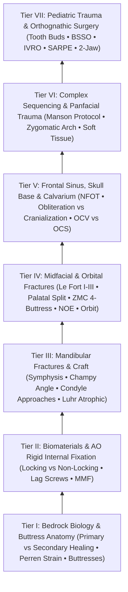

# The Craniomaxillofacial Trauma Knowledge Graph provides a structured mastery curriculum

Welcome to the **Comprehensive Craniomaxillofacial Trauma & Orthognathic Surgery Knowledge Graph** (`Trauma/`), the 7th subspecialty vault of `sk.oto`. Based on the gold-standard AO Foundation corpus (*Principles of Internal Fixation of the Craniomaxillofacial Skeleton — Trauma and Orthognathic Surgery*, Ehrenfeld, Manson, Prein / AOCMF 2012), this interconnected knowledge graph unifies bedrock bone biology, rigid internal fixation biomechanics, mandibular, midfacial, frontal sinus, calvarial, panfacial, pediatric, and orthognathic surgery into an interconnected 7-tier mastery curriculum.

> [!NOTE] **Source Document & Linear Syllabus**
> This graph is integrated with the [[Comprehensive Craniomaxillofacial Trauma Residency Mastery Curriculum & Self-Assessment Guide|original linear trauma curriculum document]]. Refer to it for the exhaustive clinical modules, operative sequences, and self-assessment checkpoints.

---

## 🗺️ Master Curriculum Navigation by Tier

### Tier I: Bedrock Biology & Buttress Anatomy
- **Primary Bone Healing**: [[Primary contact bone healing requires absolute stability with interfragmentary strain under two percent|Primary contact bone healing]]
- **Secondary Bone Healing**: [[Secondary indirect bone healing proceeds through an enchondral cartilaginous callus under relative stability|Secondary indirect callus healing]]
- **Perren Strain Mechanics**: [[Perren strain theory dictates tissue differentiation and mechanical thresholds for osteogenesis|Perren strain theory and thresholds]]
- **Cortical Blood Perfusion**: [[Centripetal periosteal and centrifugal endosteal blood supplies preserve cortical bone viability|Centripetal and centrifugal perfusion]]
- **Facial Buttress Network**: [[The facial skeleton absorbs impact forces through vertical and horizontal structural buttresses|Facial vertical and horizontal buttresses]]

### Tier II: Biomaterials & AO Rigid Fixation Principles
- **Titanium Biocompatibility**: [[Commercially pure titanium forms a passivated titanium dioxide layer ensuring biocompatibility|Titanium dioxide passivation layer]]
- **Resorbable Hardware**: [[Biodegradable copolymer osteosynthesis undergoes random hydrolytic scission eliminating hardware removal|Biodegradable copolymer osteosynthesis]]
- **Locking Fixator Mechanics**: [[Locking internal fixator plates preserve periosteal microvascular perfusion without frictional bone compression|Locking internal fixator technology]]
- **Conventional Friction Plating**: [[Locking internal fixator plates preserve periosteal microvascular perfusion without frictional bone compression|Conventional non-locking friction plating]]
- **Lag Screw Compression**: [[The lag screw principle generates interfragmentary compression by engaging solely the distal cortex|Lag screw interfragmentary compression]]
- **Load-Bearing Fixation**: [[Load-bearing fixation supports one hundred percent of functional loads in comminuted or atrophic bone|Load-bearing reconstruction doctrine]]
- **Load-Sharing Fixation**: [[Load-sharing fixation relies on anatomically interlocked bone fragments to share compressive masticatory forces|Load-sharing buttress stability]]
- **MMF Occlusal Indexing**: [[Mandibulomaxillary fixation with arch bars or cortical screws establishes the central occlusal relationship|Mandibulomaxillary fixation systems]]

### Tier III: Mandibular Fractures & Surgical Craft
- **Symphyseal Dual-Plating**: [[Mandibular symphyseal and parasymphyseal fractures require dual-plate fixation to neutralize torsional rotational vectors|Symphyseal and parasymphyseal dual-plating]]
- **Champy External Oblique Plating**: [[Mandible fractures require anatomical reduction and load-sharing miniplate fixation along Champy lines of ideal osteosynthesis|Champy lines of ideal osteosynthesis]]
- **Comminuted Angle Plating**: [[Mandibular angle fractures with comminution or bone defects mandate load-bearing reconstruction plates|Comminuted angle reconstruction plating]]
- **Condylar ORIF Indications**: [[Mandibular condyle fractures managed via open versus closed reduction depend on displacement and occlusion|Mandibular subcondylar ORIF indications]]
- **Open Condylar Approaches**: [[The preauricular and retromandibular approaches provide surgical access to condylar fractures while protecting the facial nerve|Preauricular and retromandibular approaches]]
- **Endoscopic Condylar Repair**: [[Endoscopic-assisted transoral reduction of condylar neck fractures avoids external facial nerve dissection|Endoscopic-assisted transoral condylar reduction]]
- **Atrophic Mandible Fixation**: [[Severely atrophic edentulous mandible fractures classified by Luhr mandate load-bearing reconstruction plate fixation|Luhr atrophic edentulous mandible plating]]
- **Teeth in Fracture Line**: [[Teeth in the mandibular fracture line are extracted if roots are fractured or loose but preserved if structurally intact|Tooth retention versus extraction criteria]]

### Tier IV: Midfacial & Orbital Fractures
- **Le Fort I Fixation**: [[Le Fort I fractures separate the hard palate and require bilateral buttress plate fixation|Le Fort I maxillary buttress fixation]]
- **Sagittal Palatal Split**: [[Sagittal palatal split fractures require transpalatal reduction prior to mandibulomaxillary fixation to prevent arch widening|Palatal split transverse reduction]]
- **Le Fort II & III Disjunction**: [[Le Fort II pyramidal and Le Fort III craniofacial disjunction fractures disrupt facial buttresses|Le Fort II pyramidal and Le Fort III craniofacial disjunction]]
- **ZMC Tetrapod Fixation**: [[Zygomaticomaxillary complex fractures disrupt four buttress articulations requiring multi-point reduction|ZMC four-buttress multi-point reduction]]
- **Sphenozygomatic 3D Key**: [[The sphenozygomatic suture along the lateral orbital wall serves as the primary key for three-dimensional ZMC reduction|Sphenozygomatic suture 3D alignment key]]
- **Internal Orbital Reconstruction**: [[Orbital floor blowout fractures with muscle entrapment or significant enophthalmos mandate reconstruction|Internal orbital wall reconstruction]]
- **Pediatric White-Eyed Trapdoor**: [[Pediatric white-eyed blowout fractures cause muscle entrapment requiring emergent surgical release|Pediatric white-eyed blowout trapdoor release]]
- **Retrobulbar Emergency Rescue**: [[Acute post-traumatic retrobulbar hematoma with impending vision loss requires bedside lateral canthotomy and inferior cantholysis|Bedside lateral canthotomy and cantholysis]]
- **NOE Markowitz Classification**: [[Naso-orbito-ethmoid NOE fractures staged by Markowitz and Manson require medial canthal tendon fixation|Markowitz-Manson NOE classification]]
- **Type III NOE Canthopexy**: [[Type III nasoorbitoethmoidal fractures require transnasal canthopexy directed posterior and superior to the lacrimal crest|Type III NOE transnasal canthopexy]]
- **Nasal Bone Fractures**: [[Nasal bone fractures are reduced within seven to fourteen days using closed reduction under local or general anesthesia|Nasal bone closed reduction timing]]

### Tier V: Frontal Sinus, Skull Base & Calvarium
- **Anterior Table Reconstruction**: [[Isolated anterior table frontal sinus fractures require open reduction and microplate fixation for contour restoration|Anterior table frontal sinus contour restoration]]
- **NFOT Sinus Obliteration**: [[Nasofrontal outflow tract injury with persistent obstruction mandates meticulous frontal sinus obliteration with autologous fat|Frontal sinus obliteration with autologous fat]]
- **Posterior Table Cranialization**: [[Comminuted posterior table frontal sinus fractures with dural lacerations mandate frontal sinus cranialization|Posterior table frontal sinus cranialization]]
- **Temporal Bone OCV vs OCS**: [[Temporal bone fractures classified as otic capsule violating carry high risks of sensorineural hearing loss and facial nerve transection|Temporal bone OCV versus OCS fractures]]
- **Post-Traumatic Facial Palsy**: [[Immediate complete facial nerve paralysis following temporal bone trauma warrants electroneuronography and surgical decompression|Immediate complete facial palsy decompression]]
- **Traumatic CSF Fistulas**: [[Traumatic cerebrospinal fluid otorrhea and rhinorrhea are managed conservatively before considering surgical skull base repair|Conservative vs surgical post-traumatic CSF leak repair]]
- **Depressed Calvarial Fractures**: [[Depressed cranial vault fractures exceeding full cortical bone thickness mandate surgical elevation and rigid microplate fixation|Depressed cranial vault elevation and microplating]]

### Tier VI: Complex Sequencing & Panfacial Trauma
- **Manson Panfacial Sequencing**: [[Panfacial fracture reconstruction proceeds from known stable peripheral buttresses to central occlusion|Manson systematic panfacial reconstruction sequencing]]
- **Zygomatic Arch Width**: [[Anatomical reduction of the zygomatic arch restores lateral facial width and anteroposterior malar projection in panfacial trauma|Zygomatic arch width and malar projection]]
- **Soft Tissue Resuspension**: [[Soft tissue resuspension to facial bone plates prevents post-traumatic facial drooping and lower eyelid ectropion|Soft tissue and periosteal resuspension]]

### Tier VII: Pediatric Trauma & Orthognathic Surgery
- **Pediatric Craniofacial Elasticity**: [[Pediatric craniofacial fractures demonstrate high elasticity and greenstick patterns governed by thick osteogenic periosteum|Pediatric greenstick elasticity and thick periosteum]]
- **Tooth Bud Preservation**: [[Fixation of pediatric mandibular fractures requires monocortical plates along the inferior basilar border to preserve developing tooth buds|Pediatric basilar border monocortical plating]]
- **Pediatric Condylar Remodeling**: [[Pediatric mandibular condyle fractures are managed with short-term functional mobilization to exploit biological remodeling and prevent ankylosis|Pediatric condyle functional mobilization]]
- **BSSO Position Screws**: [[Bilateral sagittal split osteotomy achieves mandibular repositioning via sagittal corticotomies and non-compressive position screw fixation|BSSO non-compressive position screws]]
- **IVRO Prognathism Correction**: [[Intraoral vertical ramus osteotomy corrects mandibular prognathism without internal fixation to eliminate condylar torquing|IVRO vertical ramus osteotomy without fixation]]
- **Le Fort I Vascular Pedicle**: [[Le Fort I downfracture osteotomy preserves collateral maxillary perfusion via the ascending palatine and ascending pharyngeal arteries|Le Fort I downfracture collateral perfusion]]
- **SARPE Maxillary Distraction**: [[Surgically assisted rapid palatal expansion combines subtotal Le Fort I osteotomies with midpalatal distraction for transverse maxillary deficiency|SARPE transverse maxillary distraction]]
- **Two-Jaw Splint Coordination**: [[Two-jaw bimaxillary orthognathic sequencing utilizes intermediate and final occlusal splints to coordinate three-dimensional repositioning|Two-jaw intermediate and final splint sequencing]]
- **BSSO Bad Split Rescue**: [[Bad split fractures during bilateral sagittal split osteotomy require immediate fragment isolation and rigid miniplate stabilization|Bad split fragment isolation and stabilization]]

---

## 🔗 Cross-Vault Integration Matrix

The `Trauma/` knowledge graph integrates with the existing six subspecialty vaults across `sk.oto`:

- **FPRS Reconstructive Interface**:
  - [[Champy lines of ideal osteosynthesis dictate monocortical miniplate fixation along mandibular tension zones|Champy lines of ideal osteosynthesis (FPRS)]]
  - [[Zygomaticomaxillary complex fractures disrupt four buttress articulations requiring multi-point reduction|ZMC multi-point buttress reduction (FPRS)]]
  - [[Le Fort I fractures separate the hard palate and require bilateral buttress plate fixation|Le Fort I maxillary buttress fixation (FPRS)]]
  - [[Orbital floor blowout fractures with muscle entrapment or significant enophthalmos mandate reconstruction|Orbital floor blowout reconstruction (FPRS)]]
- **Otology Lateral Skull Base Interface**:
  - [[The otic capsule is an immutable endochondral bone that provides fixed surgical reference landmarks|Immutable otic capsule landmarks (Otology)]]
  - [[Electroneuronography showing greater than ninety percent degeneration within fourteen days indicates severe facial nerve axonal injury|ENoG axonal degeneration thresholds (Otology)]]
  - [[Transmastoid and middle cranial fossa facial nerve decompression relieves canalicular compression|Transmastoid and middle cranial fossa facial nerve decompression (Otology)]]
  - [[Immediate direct epineurial end-to-end repair is the gold standard for transected facial nerve injury|Direct epineurial facial nerve repair (Otology)]]
- **Rhinology & Skull Base Interface**:
  - [[Endoscopic repair of cerebrospinal fluid rhinorrhea employs systematic biochemical confirmation, intrathecal fluorescein localization, and multilayer underlay dural reconstruction to achieve primary closure|Endoscopic multilayer CSF rhinorrhea repair (Sinus)]]
  - [[Beta-2 transferrin and high-resolution CT localize sinonasal CSF fistulas|Beta-2 transferrin and CT localization (Sinus)]]
  - [[Draf III modified Lothrop unites both frontal sinuses into a common cavity|Draf III modified Lothrop frontal drill-out (Sinus)]]
- **Pediatric Otolaryngology Interface**:
  - [[Pediatric white-eyed blowout fractures cause muscle entrapment requiring emergent surgical release|Pediatric white-eyed blowout trapdoor release (Pediatrics)]]
  - [[Le Fort I osteotomy and bilateral sagittal split osteotomy BSSO achieve rigid skeletal advancement in MMA|Le Fort I and BSSO skeletal advancement in MMA (Pediatrics)]]
