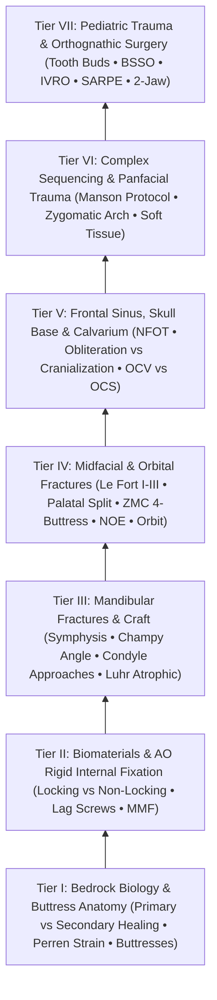

# The Craniomaxillofacial Trauma Knowledge Graph provides a structured mastery curriculum

Welcome to the **Comprehensive Craniomaxillofacial Trauma & Orthognathic Surgery Knowledge Graph** (`Trauma/`), the 7th subspecialty vault of `sk.oto`. Based on the gold-standard AO Foundation corpus (*Principles of Internal Fixation of the Craniomaxillofacial Skeleton — Trauma and Orthognathic Surgery*, Ehrenfeld, Manson, Prein / AOCMF 2012), this interconnected knowledge graph unifies bedrock bone biology, rigid internal fixation biomechanics, mandibular, midfacial, frontal sinus, calvarial, panfacial, pediatric, and orthognathic surgery into an interconnected 7-tier mastery curriculum.

> [!NOTE] **Subspecialty Knowledge Cards Census & Curriculum Architecture**
> | Metric | Value | Details |
> | :--- | :--- | :--- |
> | **Atomic Cards (Notes)** | **40** | Granular single-concept clinical and surgical factoids |
> | **Source Coverage** | **40 / 40 (100%)** | Full attribution to authoritative surgical textbooks |
> | **Active Recall Questions** | **80 total (2.0/card)** | Integrated retrieval prompts with mechanistic rationales |
> | **Illustrated Cards** | **40 notes (42 figs)** | High-yield operative line drawings and anatomical diagrams |
> | **Personal Notes Guard** | **100% verified** | Cryptographically guarded resident notes region |
> | **Active Wiki-Links** | **240 links** | Bidirectional knowledge graph traversal web |
> | **Mastery Pyramid** | **7 Progressive Tiers** | From Bedrock Foundations to High-Stakes Complication Rescue |

---

## Tier I: Bedrock Biology & Buttress Anatomy

### 🗂️ Tier I Atomic Knowledge Directory
- **Primary Bone Healing**: [[Primary contact bone healing requires absolute stability with interfragmentary strain under two percent|Primary contact bone healing]]
- **Secondary Bone Healing**: [[Secondary indirect bone healing proceeds through an enchondral cartilaginous callus under relative stability|Secondary indirect callus healing]]
- **Perren Strain Mechanics**: [[Perren strain theory dictates tissue differentiation and mechanical thresholds for osteogenesis|Perren strain theory and thresholds]]
- **Cortical Blood Perfusion**: [[Centripetal periosteal and centrifugal endosteal blood supplies preserve cortical bone viability|Centripetal and centrifugal perfusion]]
- **Facial Buttress Network**: [[The facial skeleton absorbs impact forces through vertical and horizontal structural buttresses|Facial vertical and horizontal buttresses]]

### 📖 Tier I Clinical Foundations & Craft Nuances
### Core Mechanistic Modules
1. **Bone Biology & Healing Modes**:
   - [[Primary contact bone healing requires absolute stability with interfragmentary strain under two percent|Primary contact bone healing]] occurs under absolute stability with interfragmentary strain $< 2\%$, eliminating callus formation through direct Haversian remodeling.
   - [[Secondary indirect bone healing proceeds through an enchondral cartilaginous callus under relative stability|Secondary indirect bone healing]] tolerates relative stability (strain $2\text{--}10\%$), progressing through hematoma, soft chondroid callus, hard woven bone, and lamellar remodeling.
2. **Strain Theory & Microcirculation**:
   - [[Perren strain theory dictates tissue differentiation and mechanical thresholds for osteogenesis|Perren strain theory]] dictates that granulation tissue survives strain up to $100\%$, cartilage up to $10\%$, and bone $< 2\%$.
   - [[Centripetal periosteal and centrifugal endosteal blood supplies preserve cortical bone viability|Cortical microvascular perfusion]] relies on the centrifugal endosteal and centripetal periosteal systems.
3. **Internal Fixator Mechanics**:
   - [[Locking internal fixator plates preserve periosteal microvascular perfusion without frictional bone compression|Locking internal fixators]] convert shear stress into rigid frame compression, preventing periosteal devascularization.
   - [[The lag screw principle generates interfragmentary compression by engaging solely the distal cortex|The lag screw principle]] provides maximum interfragmentary compression across oblique fracture planes.
   - [[Load-bearing fixation supports one hundred percent of functional loads in comminuted or atrophic bone|Load-bearing reconstruction]] assumes $100\%$ of physiological forces in comminuted, defect, or atrophic bone.
   - [[Load-sharing fixation relies on anatomically interlocked bone fragments to share compressive masticatory forces|Load-sharing fixation]] depends on intact cortical buttressing to share occlusal forces.

---

## Tier II: Biomaterials & AO Rigid Fixation Principles

### 🗂️ Tier II Atomic Knowledge Directory
- **Titanium Biocompatibility**: [[Commercially pure titanium forms a passivated titanium dioxide layer ensuring biocompatibility|Titanium dioxide passivation layer]]
- **Resorbable Hardware**: [[Biodegradable copolymer osteosynthesis undergoes random hydrolytic scission eliminating hardware removal|Biodegradable copolymer osteosynthesis]]
- **Locking Fixator Mechanics**: [[Locking internal fixator plates preserve periosteal microvascular perfusion without frictional bone compression|Locking internal fixator technology]]
- **Conventional Friction Plating**: [[Locking internal fixator plates preserve periosteal microvascular perfusion without frictional bone compression|Conventional non-locking friction plating]]
- **Lag Screw Compression**: [[The lag screw principle generates interfragmentary compression by engaging solely the distal cortex|Lag screw interfragmentary compression]]
- **Load-Bearing Fixation**: [[Load-bearing fixation supports one hundred percent of functional loads in comminuted or atrophic bone|Load-bearing reconstruction doctrine]]
- **Load-Sharing Fixation**: [[Load-sharing fixation relies on anatomically interlocked bone fragments to share compressive masticatory forces|Load-sharing buttress stability]]
- **MMF Occlusal Indexing**: [[Mandibulomaxillary fixation with arch bars or cortical screws establishes the central occlusal relationship|Mandibulomaxillary fixation systems]]

---

## Tier III: Mandibular Fractures & Surgical Craft

### 🗂️ Tier III Atomic Knowledge Directory
- **Symphyseal Dual-Plating**: [[Mandibular symphyseal and parasymphyseal fractures require dual-plate fixation to neutralize torsional rotational vectors|Symphyseal and parasymphyseal dual-plating]]
- **Champy External Oblique Plating**: [[Mandible fractures require anatomical reduction and load-sharing miniplate fixation along Champy lines of ideal osteosynthesis|Champy lines of ideal osteosynthesis]]
- **Comminuted Angle Plating**: [[Mandibular angle fractures with comminution or bone defects mandate load-bearing reconstruction plates|Comminuted angle reconstruction plating]]
- **Condylar ORIF Indications**: [[Mandibular condyle fractures managed via open versus closed reduction depend on displacement and occlusion|Mandibular subcondylar ORIF indications]]
- **Open Condylar Approaches**: [[The preauricular and retromandibular approaches provide surgical access to condylar fractures while protecting the facial nerve|Preauricular and retromandibular approaches]]
- **Endoscopic Condylar Repair**: [[Endoscopic-assisted transoral reduction of condylar neck fractures avoids external facial nerve dissection|Endoscopic-assisted transoral condylar reduction]]
- **Atrophic Mandible Fixation**: [[Severely atrophic edentulous mandible fractures classified by Luhr mandate load-bearing reconstruction plate fixation|Luhr atrophic edentulous mandible plating]]
- **Teeth in Fracture Line**: [[Teeth in the mandibular fracture line are extracted if roots are fractured or loose but preserved if structurally intact|Tooth retention versus extraction criteria]]

### 📖 Tier III Clinical Foundations & Craft Nuances
### Operative Decision Architecture
1. **Symphysis & Parasymphysis**:
   - [[Mandibular symphyseal and parasymphyseal fractures require dual-plate fixation to neutralize torsional rotational vectors|Symphyseal dual-plating]] neutralizes complex 3D torsional vectors using a subapical tension band miniplate and an inferior basilar border plate.
2. **Mandibular Angle**:
   - Linear non-comminuted angle fractures are stabilized along [[Mandible fractures require anatomical reduction and load-sharing miniplate fixation along Champy lines of ideal osteosynthesis|Champy's line of ideal osteosynthesis]] via a transoral approach.
   - Inferior border comminution or bone defects mandate conversion to [[Mandibular angle fractures with comminution or bone defects mandate load-bearing reconstruction plates|load-bearing reconstruction plates (2.4 mm locking)]] via an extraoral Risdon approach.
3. **Condyle & Ramus**:
   - [[The preauricular and retromandibular approaches provide surgical access to condylar fractures while protecting the facial nerve|Surgical approaches to the condyle]] balance exposure against the course of the facial nerve branches.
   - [[Endoscopic-assisted transoral reduction of condylar neck fractures avoids external facial nerve dissection|Endoscopic transoral condylar reduction]] eliminates visible facial scarring and facial nerve risk for subcondylar fractures.
4. **Special Clinical Scenarios**:
   - [[Severely atrophic edentulous mandible fractures classified by Luhr mandate load-bearing reconstruction plate fixation|Luhr atrophic edentulous mandible fractures]] require heavy load-bearing reconstruction plates placed via transcervical exposure with minimal periosteal stripping.
   - [[Teeth in the mandibular fracture line are extracted if roots are fractured or loose but preserved if structurally intact|Teeth in the fracture line]] are preserved when structurally sound to preserve occlusal indexing.

---

## Tier IV: Midfacial & Orbital Fractures

### 🗂️ Tier IV Atomic Knowledge Directory
- **Le Fort I Fixation**: [[Le Fort I fractures separate the hard palate and require bilateral buttress plate fixation|Le Fort I maxillary buttress fixation]]
- **Sagittal Palatal Split**: [[Sagittal palatal split fractures require transpalatal reduction prior to mandibulomaxillary fixation to prevent arch widening|Palatal split transverse reduction]]
- **Le Fort II & III Disjunction**: [[Le Fort II pyramidal and Le Fort III craniofacial disjunction fractures disrupt facial buttresses|Le Fort II pyramidal and Le Fort III craniofacial disjunction]]
- **ZMC Tetrapod Fixation**: [[Zygomaticomaxillary complex fractures disrupt four buttress articulations requiring multi-point reduction|ZMC four-buttress multi-point reduction]]
- **Sphenozygomatic 3D Key**: [[The sphenozygomatic suture along the lateral orbital wall serves as the primary key for three-dimensional ZMC reduction|Sphenozygomatic suture 3D alignment key]]
- **Internal Orbital Reconstruction**: [[Orbital floor blowout fractures with muscle entrapment or significant enophthalmos mandate reconstruction|Internal orbital wall reconstruction]]
- **Pediatric White-Eyed Trapdoor**: [[Pediatric white-eyed blowout fractures cause muscle entrapment requiring emergent surgical release|Pediatric white-eyed blowout trapdoor release]]
- **Retrobulbar Emergency Rescue**: [[Acute post-traumatic retrobulbar hematoma with impending vision loss requires bedside lateral canthotomy and inferior cantholysis|Bedside lateral canthotomy and cantholysis]]
- **NOE Markowitz Classification**: [[Naso-orbito-ethmoid NOE fractures staged by Markowitz and Manson require medial canthal tendon fixation|Markowitz-Manson NOE classification]]
- **Type III NOE Canthopexy**: [[Type III nasoorbitoethmoidal fractures require transnasal canthopexy directed posterior and superior to the lacrimal crest|Type III NOE transnasal canthopexy]]
- **Nasal Bone Fractures**: [[Nasal bone fractures are reduced within seven to fourteen days using closed reduction under local or general anesthesia|Nasal bone closed reduction timing]]

### 📖 Tier IV Clinical Foundations & Craft Nuances
### Architectural Buttress Restoration
1. **Buttress System**:
   - [[The facial skeleton absorbs impact forces through vertical and horizontal structural buttresses|The facial buttress framework]] absorbs impact forces through the paired medial (nasomaxillary), lateral (zygomaticomaxillary), and posterior (pterygomaxillary) vertical buttresses and transverse horizontal beams.
2. **Palatal & Le Fort Fractures**:
   - [[Sagittal palatal split fractures require transpalatal reduction prior to mandibulomaxillary fixation to prevent arch widening|Sagittal palatal split fractures]] require rigid transverse reduction prior to MMF to prevent splaying of the maxillary dental arch.
   - [[Le Fort I fractures separate the hard palate and require bilateral buttress plate fixation|Le Fort I maxillary buttress fixation]] stabilizes the dentoalveolar complex to the stable upper midface.
3. **ZMC Tetrapod & Orbit**:
   - [[The sphenozygomatic suture along the lateral orbital wall serves as the primary key for three-dimensional ZMC reduction|The sphenozygomatic suture]] along the lateral orbital wall serves as the definitive landmark for 3D alignment.
   - [[Acute post-traumatic retrobulbar hematoma with impending vision loss requires bedside lateral canthotomy and inferior cantholysis|Retrobulbar hematoma emergency]] mandates immediate bedside lateral canthotomy and inferior cantholysis without delay for imaging.
4. **NOE Complex**:
   - [[Type III nasoorbitoethmoidal fractures require transnasal canthopexy directed posterior and superior to the lacrimal crest|Type III NOE transnasal canthopexy]] directs wire vectors posterior and superior to the posterior lacrimal crest to correct traumatic telecanthus.

---

## Tier V: Frontal Sinus, Skull Base & Calvarium

### 🗂️ Tier V Atomic Knowledge Directory
- **Anterior Table Reconstruction**: [[Isolated anterior table frontal sinus fractures require open reduction and microplate fixation for contour restoration|Anterior table frontal sinus contour restoration]]
- **NFOT Sinus Obliteration**: [[Nasofrontal outflow tract injury with persistent obstruction mandates meticulous frontal sinus obliteration with autologous fat|Frontal sinus obliteration with autologous fat]]
- **Posterior Table Cranialization**: [[Comminuted posterior table frontal sinus fractures with dural lacerations mandate frontal sinus cranialization|Posterior table frontal sinus cranialization]]
- **Temporal Bone OCV vs OCS**: [[Temporal bone fractures classified as otic capsule violating carry high risks of sensorineural hearing loss and facial nerve transection|Temporal bone OCV versus OCS fractures]]
- **Post-Traumatic Facial Palsy**: [[Immediate complete facial nerve paralysis following temporal bone trauma warrants electroneuronography and surgical decompression|Immediate complete facial palsy decompression]]
- **Traumatic CSF Fistulas**: [[Traumatic cerebrospinal fluid otorrhea and rhinorrhea are managed conservatively before considering surgical skull base repair|Conservative vs surgical post-traumatic CSF leak repair]]
- **Depressed Calvarial Fractures**: [[Depressed cranial vault fractures exceeding full cortical bone thickness mandate surgical elevation and rigid microplate fixation|Depressed cranial vault elevation and microplating]]

### 📖 Tier V Clinical Foundations & Craft Nuances
### Outflow, Dura & Cranial Vault
1. **Frontal Sinus Outflow & Tables**:
   - [[Isolated anterior table frontal sinus fractures require open reduction and microplate fixation for contour restoration|Anterior table frontal sinus fractures]] are reconstructed with low-profile 1.0 mm to 1.3 mm microplates for aesthetic contour.
   - [[Nasofrontal outflow tract injury with persistent obstruction mandates meticulous frontal sinus obliteration with autologous fat|Frontal sinus obliteration with autologous fat]] prevents delayed mucocele formation when NFOT drainage is irreversibly obstructed.
   - [[Comminuted posterior table frontal sinus fractures with dural lacerations mandate frontal sinus cranialization|Posterior table cranialization]] is performed in comminuted posterior table fractures with dural lacerations to isolate the anterior cranial fossa.
2. **Temporal Bone & Facial Nerve**:
   - [[Temporal bone fractures classified as otic capsule violating carry high risks of sensorineural hearing loss and facial nerve transection|Temporal bone OCV fractures]] carry a high risk of profound sensorineural hearing loss and facial nerve injury.
   - [[Immediate complete facial nerve paralysis following temporal bone trauma warrants electroneuronography and surgical decompression|Immediate complete post-traumatic facial paralysis]] with $> 90\%$ degeneration on ENoG within 14 days warrants urgent surgical exploration and decompression.
3. **CSF Leaks & Calvarium**:
   - [[Traumatic cerebrospinal fluid otorrhea and rhinorrhea are managed conservatively before considering surgical skull base repair|Post-traumatic CSF leaks]] resolve spontaneously in $> 70\text{--}85\%$ of cases with conservative head elevation and avoidance of straining.
   - [[Depressed cranial vault fractures exceeding full cortical bone thickness mandate surgical elevation and rigid microplate fixation|Depressed cranial vault fractures]] exceeding full cortical thickness warrant operative elevation and rigid microplate stabilization.

---

## Tier VI: Complex Sequencing & Panfacial Trauma

### 🗂️ Tier VI Atomic Knowledge Directory
- **Manson Panfacial Sequencing**: [[Panfacial fracture reconstruction proceeds from known stable peripheral buttresses to central occlusion|Manson systematic panfacial reconstruction sequencing]]
- **Zygomatic Arch Width**: [[Anatomical reduction of the zygomatic arch restores lateral facial width and anteroposterior malar projection in panfacial trauma|Zygomatic arch width and malar projection]]
- **Soft Tissue Resuspension**: [[Soft tissue resuspension to facial bone plates prevents post-traumatic facial drooping and lower eyelid ectropion|Soft tissue and periosteal resuspension]]

### 📖 Tier VI Clinical Foundations & Craft Nuances
### Advanced Reconstruction & Orthognathic Craft
1. **Panfacial Sequencing**:
   - [[Anatomical reduction of the zygomatic arch restores lateral facial width and anteroposterior malar projection in panfacial trauma|Zygomatic arch reconstruction]] restores lateral facial width and anteroposterior malar projection.
   - [[Soft tissue resuspension to facial bone plates prevents post-traumatic facial drooping and lower eyelid ectropion|Soft tissue and periosteal resuspension]] anchors the midfacial soft-tissue envelope to titanium plates to prevent lower lid ectropion.
2. **Pediatric Craniofacial Trauma**:
   - [[Pediatric craniofacial fractures demonstrate high elasticity and greenstick patterns governed by thick osteogenic periosteum|Pediatric craniofacial bone elasticity]] produces greenstick fractures governed by thick, osteogenic periosteum.
   - [[Fixation of pediatric mandibular fractures requires monocortical plates along the inferior basilar border to preserve developing tooth buds|Pediatric mandibular plating]] is restricted to the inferior basilar border to preserve developing permanent tooth follicles.
   - [[Pediatric mandibular condyle fractures are managed with short-term functional mobilization to exploit biological remodeling and prevent ankylosis|Pediatric condyle fractures]] are managed with short-term functional mobilization to stimulate biological remodeling and prevent TMJ ankylosis.
3. **Orthognathic Surgery**:
   - [[Bilateral sagittal split osteotomy achieves mandibular repositioning via sagittal corticotomies and non-compressive position screw fixation|BSSO repositioning]] utilizes non-compressive position screws to avoid condylar torquing.
   - [[Intraoral vertical ramus osteotomy corrects mandibular prognathism without internal fixation to eliminate condylar torquing|IVRO setback]] corrects mandibular prognathism without internal fixation, eliminating condylar stress.
   - [[Le Fort I downfracture osteotomy preserves collateral maxillary perfusion via the ascending palatine and ascending pharyngeal arteries|Le Fort I osteotomy downfracture]] preserves collateral perfusion via the ascending palatine and ascending pharyngeal arteries.
   - [[Surgically assisted rapid palatal expansion combines subtotal Le Fort I osteotomies with midpalatal distraction for transverse maxillary deficiency|SARPE]] releases transverse buttress resistance for expansion in skeletally mature adults.
   - [[Two-jaw bimaxillary orthognathic sequencing utilizes intermediate and final occlusal splints to coordinate three-dimensional repositioning|Two-jaw bimaxillary sequencing]] uses intermediate and final occlusal splints to coordinate 3D movements.
   - [[Bad split fractures during bilateral sagittal split osteotomy require immediate fragment isolation and rigid miniplate stabilization|Bad split management]] requires fragment isolation, IAN protection, and rigid miniplate stabilization.

---

## Tier VII: Pediatric Trauma & Orthognathic Surgery

### 🗂️ Tier VII Atomic Knowledge Directory
- **Pediatric Craniofacial Elasticity**: [[Pediatric craniofacial fractures demonstrate high elasticity and greenstick patterns governed by thick osteogenic periosteum|Pediatric greenstick elasticity and thick periosteum]]
- **Tooth Bud Preservation**: [[Fixation of pediatric mandibular fractures requires monocortical plates along the inferior basilar border to preserve developing tooth buds|Pediatric basilar border monocortical plating]]
- **Pediatric Condylar Remodeling**: [[Pediatric mandibular condyle fractures are managed with short-term functional mobilization to exploit biological remodeling and prevent ankylosis|Pediatric condyle functional mobilization]]
- **BSSO Position Screws**: [[Bilateral sagittal split osteotomy achieves mandibular repositioning via sagittal corticotomies and non-compressive position screw fixation|BSSO non-compressive position screws]]
- **IVRO Prognathism Correction**: [[Intraoral vertical ramus osteotomy corrects mandibular prognathism without internal fixation to eliminate condylar torquing|IVRO vertical ramus osteotomy without fixation]]
- **Le Fort I Vascular Pedicle**: [[Le Fort I downfracture osteotomy preserves collateral maxillary perfusion via the ascending palatine and ascending pharyngeal arteries|Le Fort I downfracture collateral perfusion]]
- **SARPE Maxillary Distraction**: [[Surgically assisted rapid palatal expansion combines subtotal Le Fort I osteotomies with midpalatal distraction for transverse maxillary deficiency|SARPE transverse maxillary distraction]]
- **Two-Jaw Splint Coordination**: [[Two-jaw bimaxillary orthognathic sequencing utilizes intermediate and final occlusal splints to coordinate three-dimensional repositioning|Two-jaw intermediate and final splint sequencing]]
- **BSSO Bad Split Rescue**: [[Bad split fractures during bilateral sagittal split osteotomy require immediate fragment isolation and rigid miniplate stabilization|Bad split fragment isolation and stabilization]]

---

---

## 📝 Residency Self-Assessment Checkpoints

> [!TIP] **Self-Assessment Checkpoint 1: Biomechanics & Hardware**
> - *Question*: Why does placing a lag screw across a BSSO gap cause condylar torquing, whereas a position screw preserves condylar seating?
> - *Mechanism*: Review [[Bilateral sagittal split osteotomy achieves mandibular repositioning via sagittal corticotomies and non-compressive position screw fixation|BSSO non-compressive position screws]] and [[The lag screw principle generates interfragmentary compression by engaging solely the distal cortex|the lag screw principle]].

> [!TIP] **Self-Assessment Checkpoint 2: Emergency Ophthalmology**
> - *Question*: What is the immediate bedside procedure for post-traumatic retrobulbar hematoma with an IOP $> 40\text{ mmHg}$ and an APD?
> - *Mechanism*: Review [[Acute post-traumatic retrobulbar hematoma with impending vision loss requires bedside lateral canthotomy and inferior cantholysis|bedside lateral canthotomy and inferior cantholysis]].

> [!TIP] **Self-Assessment Checkpoint 3: Pediatric Tooth Buds**
> - *Question*: Where must miniplates be positioned in a 6-year-old child with a displaced parasymphyseal fracture?
> - *Mechanism*: Review [[Fixation of pediatric mandibular fractures requires monocortical plates along the inferior basilar border to preserve developing tooth buds|pediatric mandibular basilar plating]].

---

## 🔗 Cross-Vault Integration Matrix

The `Trauma/` knowledge graph integrates with the existing six subspecialty vaults across `sk.oto`:

- **FPRS Reconstructive Interface**:
  - [[Champy lines of ideal osteosynthesis dictate monocortical miniplate fixation along mandibular tension zones|Champy lines of ideal osteosynthesis (FPRS)]]
  - [[Zygomaticomaxillary complex fractures disrupt four buttress articulations requiring multi-point reduction|ZMC multi-point buttress reduction (FPRS)]]
  - [[Le Fort I fractures separate the hard palate and require bilateral buttress plate fixation|Le Fort I maxillary buttress fixation (FPRS)]]
  - [[Orbital floor blowout fractures with muscle entrapment or significant enophthalmos mandate reconstruction|Orbital floor blowout reconstruction (FPRS)]]
- **Otology Lateral Skull Base Interface**:
  - [[The otic capsule is an immutable endochondral bone that provides fixed surgical reference landmarks|Immutable otic capsule landmarks (Otology)]]
  - [[Electroneuronography showing greater than ninety percent degeneration within fourteen days indicates severe facial nerve axonal injury|ENoG axonal degeneration thresholds (Otology)]]
  - [[Transmastoid and middle cranial fossa facial nerve decompression relieves canalicular compression|Transmastoid and middle cranial fossa facial nerve decompression (Otology)]]
  - [[Immediate direct epineurial end-to-end repair is the gold standard for transected facial nerve injury|Direct epineurial facial nerve repair (Otology)]]
- **Rhinology & Skull Base Interface**:
  - [[Endoscopic repair of cerebrospinal fluid rhinorrhea employs systematic biochemical confirmation, intrathecal fluorescein localization, and multilayer underlay dural reconstruction to achieve primary closure|Endoscopic multilayer CSF rhinorrhea repair (Sinus)]]
  - [[Beta-2 transferrin and high-resolution CT localize sinonasal CSF fistulas|Beta-2 transferrin and CT localization (Sinus)]]
  - [[Draf III modified Lothrop unites both frontal sinuses into a common cavity|Draf III modified Lothrop frontal drill-out (Sinus)]]
- **Pediatric Otolaryngology Interface**:
  - [[Pediatric white-eyed blowout fractures cause muscle entrapment requiring emergent surgical release|Pediatric white-eyed blowout trapdoor release (Pediatrics)]]
  - [[Le Fort I osteotomy and bilateral sagittal split osteotomy BSSO achieve rigid skeletal advancement in MMA|Le Fort I and BSSO skeletal advancement in MMA (Pediatrics)]]
