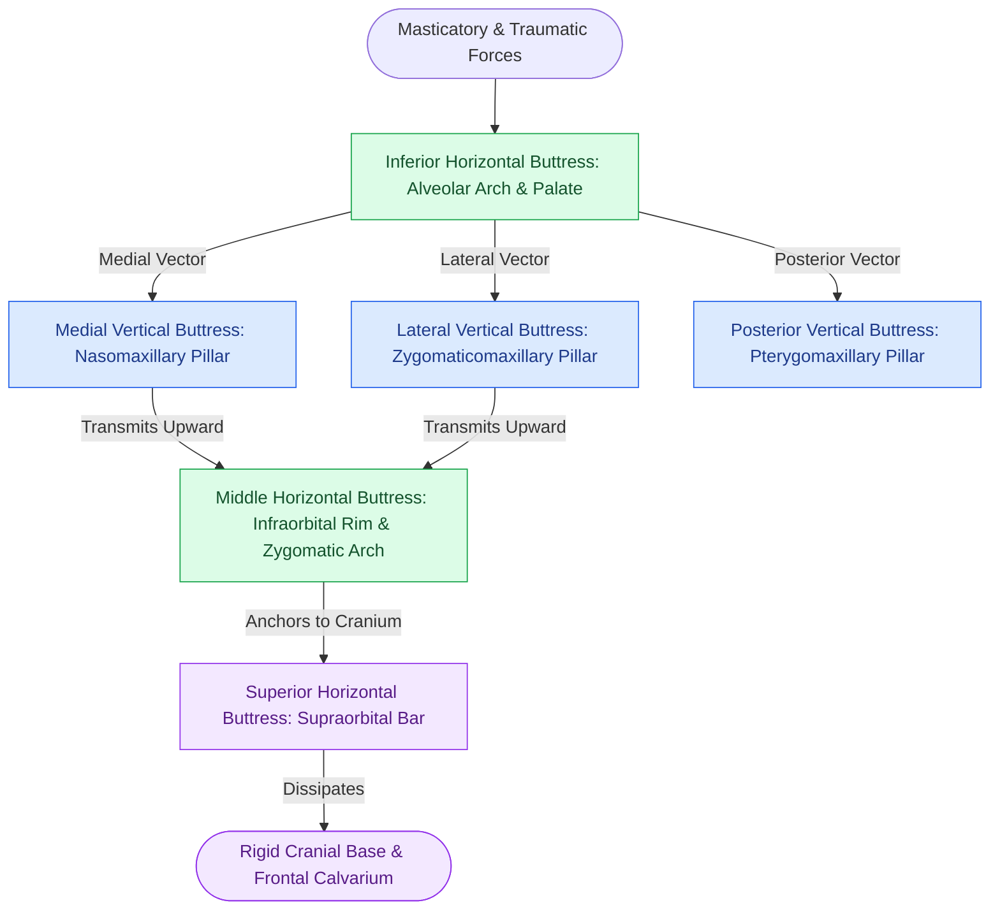

# The facial skeleton absorbs impact forces through vertical and horizontal structural buttresses

## Active Recall

> [!question]- Name the three primary paired vertical buttresses and three primary horizontal buttresses of the craniomaxillofacial skeleton.
> *Answer / Clinical Rationale*: 
> - **Vertical Buttresses**: (1) **Nasomaxillary (Medial)** buttress (pyriform aperture margin to frontal bone); (2) **Zygomaticomaxillary (Lateral)** buttress (first molar alveolus to zygoma and frontal process); and (3) **Pterygomaxillary (Posterior)** buttress (maxillary tuberosity to pterygoid plates).
> - **Horizontal Buttresses**: (1) **Superior (Supraorbital)** bar (frontal bone and orbital roof); (2) **Middle (Infraorbital & Zygomatic Arch)** buttress (infraorbital rim, malar body, and zygomatic arch); and (3) **Inferior (Alveolar & Palatal)** buttress (maxillary alveolar ridge and hard palate).

> [!question]- How does the anatomical architecture of thin sinus walls suspended between thick buttresses function as an evolutionary protective crumple zone?
> *Answer / Clinical Rationale*: The facial skeleton is engineered as a mechanical energy-absorbing crumple zone. The thin walls of the maxillary, ethmoid, and sphenoid sinuses fracture and collapse under blunt impact forces, absorbing kinetic energy and cushioning the deceleration impact. This dissipates trauma and prevents high-energy vectors from transmitting directly into the rigid cranial vault, brainstem, and cervical spine.

## Core Clinical & Mechanistic Principles

The surgical reconstruction of midfacial fractures is predicated on the **buttress concept**. The human midface does not possess uniform bone thickness; instead, it consists of fragile, paper-thin sinus membranes and bony laminae suspended within a rigid framework of vertical and horizontal structural columns. Aligning these columns is critical to re-establishing stable [[Le Fort I fractures separate the hard palate and require bilateral buttress plate fixation|maxillary buttress projection]].

Surgical reconstruction mandates restoring the continuity and 3D alignment of these buttresses:
1. **Vertical Buttress Function**: Dictates **anterior and posterior facial height**. Failure to rigidly reconstruct the nasomaxillary and zygomaticomaxillary pillars results in vertical shortening and an anterior open bite deformity.
2. **Horizontal Buttress Function**: Dictates **facial width and anteroposterior projection**. Disruption of the zygomatic arches and alveolar arches leads to lateral splaying, a flattened dish-face appearance, and transverse crossbites.
3. **Rigid Fixation Placement**: Miniplates must be contoured and fixed directly along the dense cortical bone of the buttresses; placing screws into thin inter-buttress bone (e.g., canine fossa or anterior maxillary wall) provides zero screw purchase and results in immediate fixation failure.

## Connected Concepts & Graph Traversal
- **🔗 Malar Buttress Alignment (FPRS)**: [[Zygomaticomaxillary complex fractures disrupt four buttress articulations requiring multi-point reduction|ZMC Multi-Point Rigid Fixation]]
- **🔗 Panfacial Frame Reconstruction (FPRS)**: [[Panfacial fracture reconstruction proceeds from known stable peripheral buttresses to central occlusion|Panfacial Occlusal Anchoring]]
- **Palatal Arc Integrity**: [[Sagittal palatal split fractures require transpalatal reduction prior to mandibulomaxillary fixation to prevent arch widening|Palatal Fracture Transverse Reduction]]
- **Midfacial Le Fort Columns**: [[Le Fort I fractures separate the hard palate and require bilateral buttress plate fixation|Le Fort I Maxillary Buttress Fixation]]
- **🔗 Orbital Rim Structure (FPRS)**: [[Orbital floor blowout fractures with muscle entrapment or significant enophthalmos mandate reconstruction|Orbital Wall Reconstruction]]
