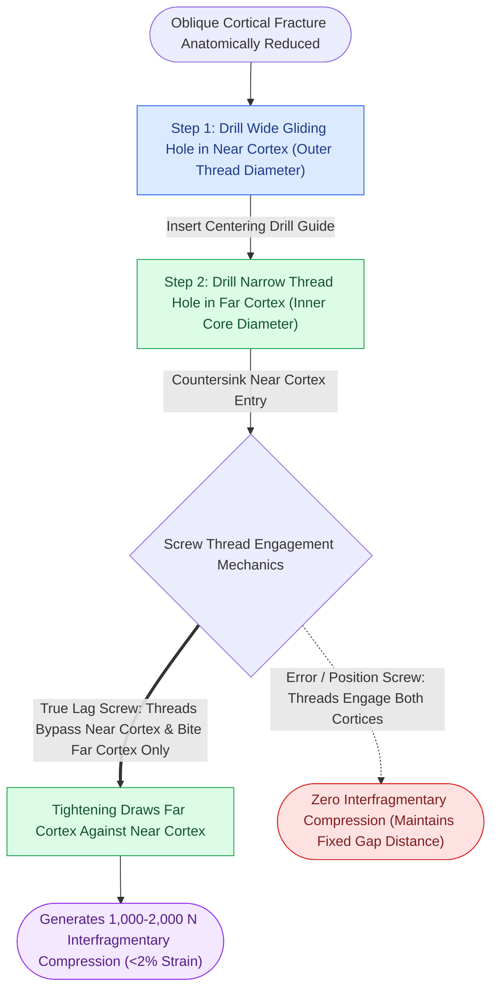

# The lag screw principle generates interfragmentary compression by engaging solely the distal cortex

## Active Recall

> [!question]- What are the four precise technical steps required to insert a lag screw across an oblique craniomaxillofacial fracture?
> *Answer / Clinical Rationale*: (1) Drill the **gliding hole** through the near (proximal) cortex using a drill bit equal to the outer thread diameter of the screw (e.g., $2.0\text{ mm}$ bit for a $2.0\text{ mm}$ screw). (2) Insert a drill sleeve into the gliding hole and drill the **thread hole** through the far (distal) cortex using the smaller core pilot bit (e.g., $1.5\text{ mm}$ bit). (3) **Countersink** the proximal outer cortex to seat the screw head evenly and prevent stress concentration. (4) Drive the screw home: as the head impinges on the countersunk outer cortex, threads engage solely in the far fragment, drawing the two cortices together under high interfragmentary compression.

> [!question]- Why must a lag screw be oriented strictly perpendicular to the fracture plane rather than perpendicular to the outer cortical bone surface?
> *Answer / Clinical Rationale*: If a lag screw is placed perpendicular to the outer bone surface across an oblique fracture, tightening the screw generates an unresolved shearing force parallel to the fracture plane, causing translational slippage, shortening, and loss of anatomical reduction. Orienting the screw **strictly perpendicular to the fracture line** converts all torque directly into perpendicular compressive force, eliminating shear and maximizing frictional interlock.

## Core Clinical & Mechanistic Principles

The **lag screw principle** represents the most efficient method of producing absolute stability and primary contact bone healing without the bulk of a plate. By generating active interfragmentary compression across a fracture plane, the normal masticatory and bending forces are converted into compressive friction between opposing cortical surfaces.

In the craniomaxillofacial skeleton, lag screws are primarily utilized in:
1. **Mandibular Symphysis and Parasymphysis**: Two $2.4\text{ mm}$ lag screws placed horizontally across an oblique sagittal fracture line produce outstanding rigidity against rotational and torsional splay, often avoiding the need for [[Mandible fractures require anatomical reduction and load-sharing miniplate fixation along Champy lines of ideal osteosynthesis|bulky mandibular miniplates]].
2. **Mandibular Body and Angle Oblique Fractures**: Sagittal fractures of the lower border can be rigidly compressed using bicortical lag screws.
3. **ZMC and Orbital Rim Fractures**: Micro-lag screws ($1.3\text{ mm}$ or $1.5\text{ mm}$) secure frontomaxillary or orbital rim bone fragments.

A fundamental distinction exists between a **true lag screw** (which features a smooth, unthreaded shank near the head or a gliding hole) and a **position screw**. A position screw has threads engaging both cortices; it holds fragments in a fixed spatial relationship without exerting compression, which is mandatory when bridging osteotomies where fragment compression would torque condylar position.

## Connected Concepts & Graph Traversal
- **Biological Healing Threshold**: [[Primary contact bone healing requires absolute stability with interfragmentary strain under two percent|Primary Contact Bone Healing Threshold]]
- **Fixed-Angle Plate Alternative**: [[Locking internal fixator plates preserve periosteal microvascular perfusion without frictional bone compression|Locking Internal Fixator Technology]]
- **🔗 Buttress Multi-Point Alignment (FPRS)**: [[Zygomaticomaxillary complex fractures disrupt four buttress articulations requiring multi-point reduction|ZMC Multi-Point Rigid Fixation]]
- **Symphyseal Compression Craft**: [[Mandibular symphyseal and parasymphyseal fractures require dual-plate fixation to neutralize torsional rotational vectors|Mandibular Symphysis & Parasymphysis Fixation]]
- **🔗 Condylar Mobility Protection (FPRS)**: [[Mandibular condyle fractures managed via open versus closed reduction depend on displacement and occlusion|Condylar Fracture Management]]
