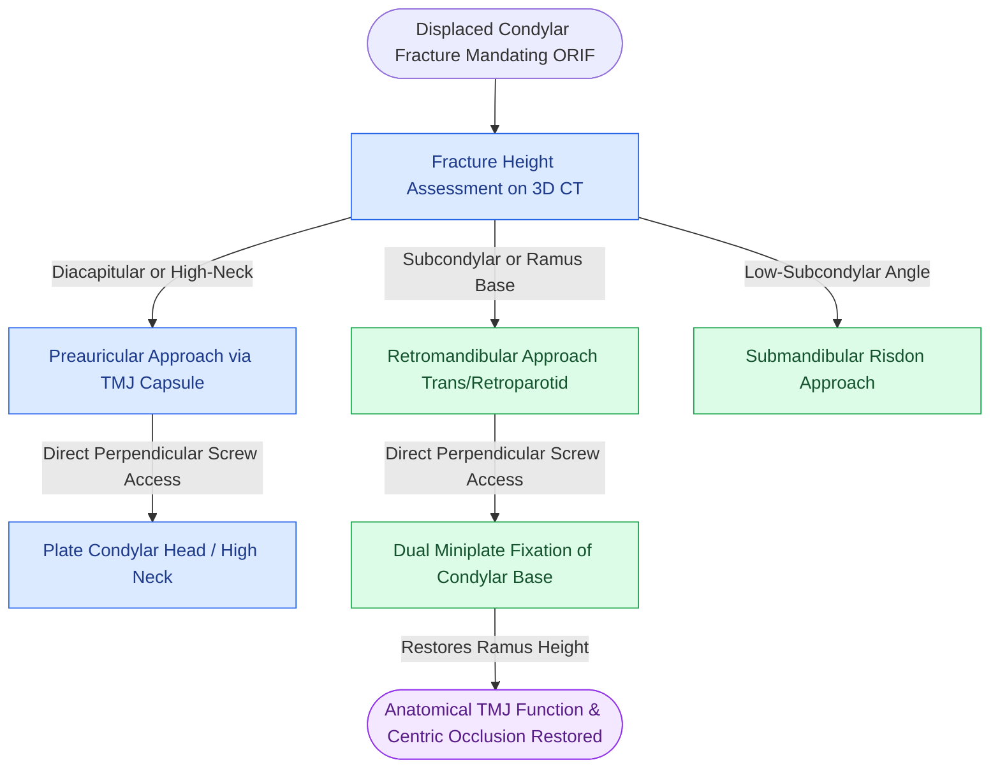

# The preauricular and retromandibular approaches provide surgical access to condylar fractures while protecting the facial nerve

## Active Recall

> [!question]- Compare the preauricular approach and retromandibular approach regarding anatomical exposure zone and facial nerve branches at risk.
> *Answer / Clinical Rationale*: 
> - **Preauricular Approach**: Best for **diacapitular (condylar head) and high condylar neck** fractures. Incision placed in the preauricular crease, dissecting through superficial temporal fascia to the deep temporalis fascia and lateral TMJ capsule. Primary nerve at risk is the **temporal (frontal) branch of CN VII** crossing the zygomatic arch.
> - **Retromandibular Approach (Hinds / Transparotid or Retroparotid)**: Best for **condylar base and subcondylar** fractures. Incision placed $0.5\text{ cm}$ below the earlobe along the posterior border of the ramus. Primary nerves at risk are the **marginal mandibular and buccal branches of CN VII**, alongside the retromandibular vein.

> [!question]- Explain the Al-Kayat and Bramley fascial dissection technique used during the preauricular approach to safeguard the frontal branch of CN VII.
> *Answer / Clinical Rationale*: The incision is carried through skin and subcutaneous tissue down to the glistening **deep temporalis fascia** (above the zygomatic arch). Dissection then proceeds deep to the **superficial temporal (temporoparietal) fascia**, which contains the frontal branch of CN VII. At $2\text{ cm}$ above the zygomatic arch, the deep temporalis fascia splits into superficial and deep layers containing the intermediate fat pad. Incising the outer leaf of deep temporalis fascia allows the surgeon to elevate the periosteum over the arch, elevating the facial nerve safely within the anterior soft-tissue flap.

## Core Clinical & Mechanistic Principles

Open reduction and internal fixation (ORIF) of the mandibular condyle restores vertical ramus height, re-establishes pre-traumatic occlusion, and eliminates the need for prolonged mandibulomaxillary fixation. However, the condylar region is surrounded by the branches of the [[The preauricular and retromandibular approaches provide surgical access to condylar fractures while protecting the facial nerve|facial nerve (CN VII)]], demanding meticulous anatomical approaches tailored to fracture height.

Approach characteristics:
1. **Preauricular Approach**:
   - Incision: Curvilinear or modified question-mark incision anterior to the helix/tragus.
   - Dissection plane: Direct exposure of TMJ capsule, condylar head, and upper neck.
   - Craft Pearl: Dissect directly on the tragal cartilage and superficial temporal vessels to protect the frontal branch of CN VII.
2. **Retromandibular Approach**:
   - Incision: Vertical incision $0.5\text{--}1.0\text{ cm}$ posterior to the posterior border of the ramus, extending $3\text{--}4\text{ cm}$ inferiorly from the lobule.
   - Dissection:
     - *Transparotid*: Traverses parotid parenchyma; facial nerve branches (buccal and marginal mandibular) are identified and mobilized with nerve stimulator.
     - *Retroparotid*: Dissects posterior to the parotid gland along the anterior border of the SCM, retracting the parotid gland anteriorly to avoid intraglandular dissection.
3. **Fixation Standard**: Subcondylar fractures require **two miniplates** (or a specialized trapezoidal/rhombic condylar plate) along the anterior and posterior borders of the condylar neck to counteract tension and compressive moments during jaw opening.

## Connected Concepts & Graph Traversal
- **Condylar ORIF Indications**: [[Mandibular condyle fractures managed via open versus closed reduction depend on displacement and occlusion|Condylar Fracture Management]]
- **Endoscopic Transoral Alternative**: [[Endoscopic-assisted transoral reduction of condylar neck fractures avoids external facial nerve dissection|Endoscopic-Assisted Condylar Reduction]]
- **Tension Band Symphysis Fixation**: [[Mandibular symphyseal and parasymphyseal fractures require dual-plate fixation to neutralize torsional rotational vectors|Mandibular Symphysis Dual-Plating]]
- **Occlusal Realignment**: [[Mandibulomaxillary fixation with arch bars or cortical screws establishes the central occlusal relationship|Mandibulomaxillary Fixation Principles]]
- **Load-Bearing Reconstruction**: [[Mandibular angle fractures with comminution or bone defects mandate load-bearing reconstruction plates|Comminuted Angle Reconstruction Plating]]
