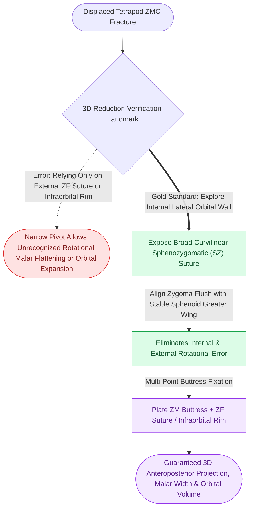

# The sphenozygomatic suture along the lateral orbital wall serves as the primary key for three-dimensional ZMC reduction

## Active Recall

> [!question]- Why is the sphenozygomatic (SZ) suture along the lateral orbital wall considered the most reliable anatomical landmark for 3D ZMC reduction?
> *Answer / Clinical Rationale*: The zygomaticofrontal (ZF) suture, infraorbital rim, and zygomaticomaxillary (ZM) buttress are narrow cortical edges that can appear reduced while the zygoma remains severely rotated around its vertical or horizontal axis. In contrast, the **sphenozygomatic suture** is a broad, planar, linear articulation extending deeply along the lateral orbital wall (between the greater wing of the sphenoid and the zygoma). Because it has broad surface area, even a $1\text{ mm}$ translational shift or $5^\circ$ rotational tilt produces an obvious visible step-off; aligning the SZ suture guarantees 3D reduction across all planes.

> [!question]- How does the surgeon access and visualize the sphenozygomatic suture intraoperatively?
> *Answer / Clinical Rationale*: The SZ suture is visualized through a **transconjunctival incision** (with lateral canthotomy/cantholysis) or a subciliary approach. Dissection proceeds subperiosteally along the orbital floor and up the lateral orbital wall, elevating the periorbita to expose the internal lateral orbital wall $15\text{--}20\text{ mm}$ posterior to the lateral orbital rim.

## Core Clinical & Mechanistic Principles

Zygomaticomaxillary complex (ZMC) fractures are tetrapod injuries involving the four major facial buttress pillars. A frequent error in midfacial trauma surgery is relying exclusively on the external orbital rim (ZF suture or infraorbital rim) to judge reduction, which fails to restore the [[The facial skeleton absorbs impact forces through vertical and horizontal structural buttresses|facial buttress framework]].

Clinical biomechanics of ZMC alignment:
1. **The Rotational Pivot**: The zygoma rotates primarily in two planes: internal rotation (depresses the malar eminence and splays the zygomatic arch outward) or external rotation (widens the orbital cavity and causes enophthalmos).
2. **The Key Articulation**: The greater wing of the sphenoid is part of the stable cranial base; it does not move during facial trauma. Aligning the mobile zygoma flush with the stationary sphenoid bone inside the orbit eliminates rotational error.
3. **Fixation Sequence**: Once the SZ suture is verified flush:
   - First: Plate the zygomaticomaxillary (ZM) buttress via intraoral gingivobuccal approach (resists masseteric downward pull).
   - Second: Plate the ZF suture or infraorbital rim.
   - Third: Explore and reconstruct the orbital floor if comminution or fat herniation is present.

## Connected Concepts & Graph Traversal
- **Multi-Point Buttress Fixation**: [[Zygomaticomaxillary complex fractures disrupt four buttress articulations requiring multi-point reduction|ZMC Multi-Point Rigid Fixation]]
- **Orbital Reconstruction**: [[Orbital floor blowout fractures with muscle entrapment or significant enophthalmos mandate reconstruction|Orbital Wall Reconstruction]]
- **Panfacial Projection**: [[Panfacial fracture reconstruction proceeds from known stable peripheral buttresses to central occlusion|Panfacial Occlusal Anchoring]]
- **Palatal Arc Integrity**: [[Sagittal palatal split fractures require transpalatal reduction prior to mandibulomaxillary fixation to prevent arch widening|Palatal Fracture Transverse Reduction]]
- **Locking Plate Design**: [[Locking internal fixator plates preserve periosteal microvascular perfusion without frictional bone compression|Locking Internal Fixator Technology]]
