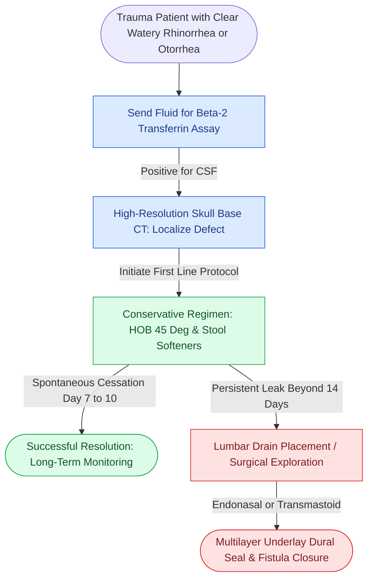

# Traumatic cerebrospinal fluid otorrhea and rhinorrhea are managed conservatively before considering surgical skull base repair

## Active Recall

> [!question]- What is the standard conservative protocol for post-traumatic CSF rhinorrhea and otorrhea, and what percentage of leaks resolve spontaneously?
> *Answer / Clinical Rationale*: Over **70% to 85% of post-traumatic CSF leaks resolve spontaneously within 7 to 10 days** without surgical intervention. The conservative regimen includes: (1) Strict bed rest with the **head of bed elevated 30° to 45°** to lower intracranial resting pressure; (2) Avoidance of nose blowing, coughing, sneezing, and Valsalva maneuvers (stool softeners administered); (3) Avoidance of nasal packing; (4) **Prophylactic antibiotics are NOT recommended**, as randomized trials demonstrate they do not prevent meningitis and select for resistant pathogens.

> [!question]- When conservative management fails, what surgical techniques and timeframes govern skull base CSF fistula repair?
> *Answer / Clinical Rationale*: Surgical repair is indicated if CSF leakage **persists beyond 7 to 14 days**, or immediately in cases of penetrating injury, gross skull base comminution, or recurrent meningitis. Anterior skull base defects (cribriform, ethmoid roof, sphenoid) are repaired via **endoscopic endonasal multilayer closure** using autologous fascia lata, mucosal grafts, and vascularized nasoseptal flaps. Lateral skull base tegmen defects with persistent otorrhea are repaired via transmastoid or middle cranial fossa craniotomy.

## Core Clinical & Mechanistic Principles

Traumatic skull base fractures disrupt the dura mater and arachnoid membrane, creating an abnormal communication between the subarachnoid space and the paranasal sinuses or middle ear. Confirming the leak is accomplished biochemically by detecting [[Beta-2 transferrin and high-resolution CT localize sinonasal CSF fistulas|Beta-2 transferrin]], the pathognomonic diagnostic gold standard.

Clinical decision points:
1. **Target Sign and Halo Test**: While bedside filtering of blood-tinged discharge onto filter paper (showing an inner ring of blood and outer ring of clear CSF) is suggestive, beta-2 transferrin or beta-trace protein electrophoresis is required for definitive confirmation.
2. **Lumbar Drainage**: A continuous lumbar subarachnoid drain (draining 10 mL/hr) can be placed for 3 to 5 days to reduce CSF pulsatile pressure against the healing dural tear before subjecting the patient to open surgery.
3. **Endoscopic Multilayer Closure**: Modern endoscopic techniques utilize an "underlay" layer of fascia placed intracranial to the bone, followed by an "overlay" layer of bone/cartilage and a vascularized mucosal flap, achieving success rates > 90–95%.

## Connected Concepts & Graph Traversal
- **Posterior Table Cranialization**: [[Comminuted posterior table frontal sinus fractures with dural lacerations mandate frontal sinus cranialization|Posterior Table Cranialization]]
- **Endoscopic Fistula Repair**: [[Endoscopic repair of cerebrospinal fluid rhinorrhea employs systematic biochemical confirmation, intrathecal fluorescein localization, and multilayer underlay dural reconstruction to achieve primary closure|Endoscopic Multilayer CSF Leak Repair]]
- **Lateral Skull Base Repair**: [[Spontaneous CSF otorrhea from tegmen dehiscence requires multilayer middle fossa or transmastoid repair|Tegmen Dehiscence Repair]]
- **Temporal Bone Trauma**: [[Temporal bone fractures classified as otic capsule violating carry high risks of sensorineural hearing loss and facial nerve transection|Temporal Bone OCV Fractures]]
- **Vascularized Flap Closure**: [[Vascularized nasoseptal and regional pedicled flaps provide robust skull base reconstruction for high-flow CSF leaks and large dural defects|Vascularized Nasoseptal Flap Reconstruction]]
