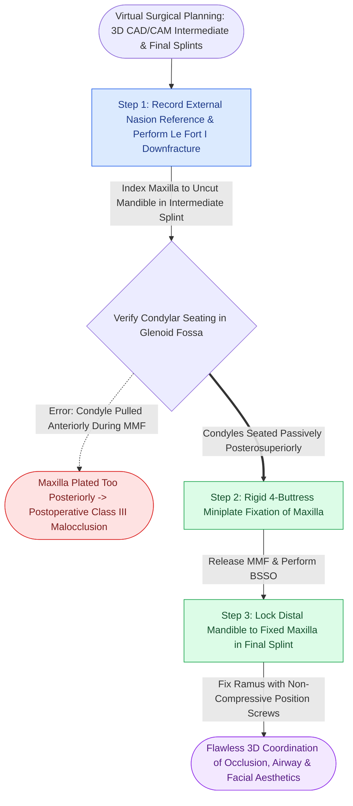

# Two-jaw bimaxillary orthognathic sequencing utilizes intermediate and final occlusal splints to coordinate three-dimensional repositioning

## Active Recall

> [!question]- What are the key indications, advantages, and sequencing choices between "Maxilla-First" versus "Mandible-First" approaches in bimaxillary orthognathic surgery?
> *Answer / Clinical Rationale*: 
> - **Maxilla-First Sequencing (Standard)**: Le Fort I osteotomy is performed first; the mobilized maxilla is indexed to the unoperated mandible using an **intermediate occlusal splint** and rigidly plated. The mandible is then split (BSSO) and advanced/set back into the **final splint**. Advantage: highly stable mandibular base for referencing maxillary vertical and sagittal position.
> - **Mandible-First Sequencing**: The BSSO is completed first; the mandible is moved into its planned position relative to the unoperated maxilla. Indicated when: large maxillary downgrafts are planned, multi-piece maxillary segmentation increases instability, or when condylar seating can be verified more reliably prior to maxillary repositioning.

> [!question]- How do intermediate and final occlusal splints translate virtual surgical planning (VSP) into precise operative repositioning?
> *Answer / Clinical Rationale*: An **intermediate splint** captures the relationship between the planned neo-position of the first operated jaw and the untouched, native anatomy of the second jaw. The **final splint** coordinates the definitive dental occlusion (Class I canine and molar intercuspation, midline alignment, and transverse arch coordination) between both osteotomized jaws. Splints eliminate three-dimensional pitch, roll, and yaw errors during rigid miniplate fixation.

## Core Clinical & Mechanistic Principles

Bimaxillary surgery addresses complex three-dimensional dentofacial deformities across all anatomical planes. Execution requires temporary [[Mandibulomaxillary fixation with arch bars or cortical screws establishes the central occlusal relationship|centric relation mandibulomaxillary fixation]] to register intermediate positions accurately.

Operative pearls:
1. **Vertical Reference Landmarks**: Before downfracturing the maxilla, a stable external reference point (such as a K-wire in the nasion or an orthodontic bracket measure) must be recorded to ensure vertical maxillary repositioning (impaction or downgrafting) matches the virtual plan exactly.
2. **Condylar Seating in Intermediate Position**: When securing the maxilla against the intact mandible in the intermediate splint, the surgeon must ensure the mandibular condyles remain seated fully in the glenoid fossae; if the condyle is subluxated forward, the maxilla will be plated too far posteriorly.
3. **Occlusal Settling**: Final splints are often maintained with light guiding elastics for 2 to 4 weeks postoperatively to guide orthodontic finishing.

## Connected Concepts & Graph Traversal
- **Maxillary Perfusion**: [[Le Fort I downfracture osteotomy preserves collateral maxillary perfusion via the ascending palatine and ascending pharyngeal arteries|Le Fort I Osteotomy Perfusion]]
- **BSSO Fixation Craft**: [[Bilateral sagittal split osteotomy achieves mandibular repositioning via sagittal corticotomies and non-compressive position screw fixation|BSSO Position Screws]]
- **Bad Split Management**: [[Bad split fractures during bilateral sagittal split osteotomy require immediate fragment isolation and rigid miniplate stabilization|Bad Split Management]]
- **Midfacial Buttress Architecture**: [[The facial skeleton absorbs impact forces through vertical and horizontal structural buttresses|Facial Buttress Architecture]]
- **Primary Bone Healing**: [[Primary contact bone healing requires absolute stability with interfragmentary strain under two percent|Primary Bone Healing]]
