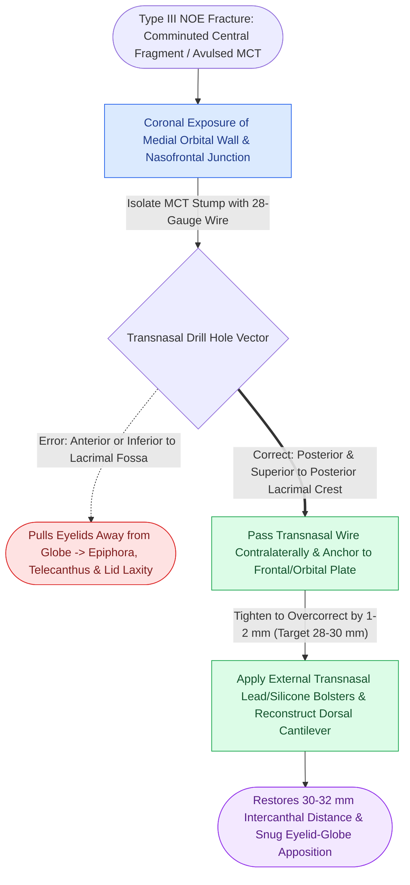

# Type III nasoorbitoethmoidal fractures require transnasal canthopexy directed posterior and superior to the lacrimal crest

## Active Recall

> [!question]- Detail the Markowitz and Manson classification of nasoorbitoethmoidal (NOE) fractures and explain how it dictates surgical fixation.
> *Answer / Clinical Rationale*: The classification is determined by the degree of comminution and the attachment of the **medial canthal tendon (MCT) to the central bone fragment**:
> - **Type I**: Single large non-comminuted central fragment with intact attached MCT. Fixation: 3-point miniplate fixation (superior to frontal bone, inferior to infraorbital rim, medial to pyriform).
> - **Type II**: Comminuted central fragment, but MCT remains attached to a substantial bone piece. Fixation: Interfragmentary microplating + transnasal wiring or miniplates.
> - **Type III**: Severe comminution with complete detachment or avulsion of the MCT from bone fragments. Fixation: Requires **formal transnasal canthopexy** with stainless steel wire or braided suture.

> [!question]- Why must the transnasal canthopexy vector be directed strictly posterior and superior to the posterior lacrimal crest?
> *Answer / Clinical Rationale*: The anatomical vector of the natural medial canthal tendon wraps around the lacrimal sac and inserts into the posterior lacrimal crest. If a canthopexy wire is directed anteriorly or straight across to the contralateral nasal bone, the medial eyelid pulls forward and away from the globe. This produces severe **traumatic telecanthus, canthal rounding, lateral eyelid laxity, and failure of the lacrimal pump mechanism**, causing permanent epiphora. Anchoring posterior and superior restores intimate eyelid-globe apposition.

## Core Clinical & Mechanistic Principles

The nasoorbitoethmoidal (NOE) complex represents the anatomical confluence of the frontal, nasal, maxillary, and ethmoid bones. The hallmark of NOE injury is displacement of the **central fragment** carrying the insertion of the medial canthal tendon (MCT), which anchors the orbicularis oculi and lacrimal apparatus. Correcting this deformity requires precise integration with [[The facial skeleton absorbs impact forces through vertical and horizontal structural buttresses|midfacial buttress reconstruction]].

Surgical craft essentials:
1. **Clinical Diagnosis**: Look for traumatic telecanthus (normal intercanthal distance = $30\text{--}34\text{ mm}$ in adults, or roughly equal to the palpebral fissure width). The **bimanual palpation test** (inserting a Kelly clamp into the nasal cavity beneath the medial canthus while palpating externally) confirms mobile central fragment dislocation.
2. **Overcorrection Rule**: The canthopexy wire must be tightened to **overcorrect the intercanthal distance by $1\text{--}2\text{ mm}$** (target $\approx 28\text{--}30\text{ mm}$ intraoperatively) because soft tissue edema and postoperative relaxation invariably cause $1\text{--}2\text{ mm}$ of late drift.
3. **External Bolsters**: Lead plates or silicone bolsters secured with transnasal mattress wires are placed externally across the nasal bridge for 10–14 days to adapt the skin envelope to the underlying skeleton and prevent seroma/dead space formation.

## Connected Concepts & Graph Traversal
- **ZMC Sphenozygomatic Alignment**: [[The sphenozygomatic suture along the lateral orbital wall serves as the primary key for three-dimensional ZMC reduction|Sphenozygomatic Suture Reduction]]
- **Retrobulbar Emergency Rescue**: [[Acute post-traumatic retrobulbar hematoma with impending vision loss requires bedside lateral canthotomy and inferior cantholysis|Retrobulbar Hematoma Emergency Rescue]]
- **Panfacial Frame Reconstruction**: [[Panfacial fracture reconstruction proceeds from known stable peripheral buttresses to central occlusion|Panfacial Occlusal Anchoring]]
- **Orbital Internal Reconstruction**: [[Orbital floor blowout fractures with muscle entrapment or significant enophthalmos mandate reconstruction|Orbital Wall Reconstruction]]
- **Maxillary Buttress Foundation**: [[Le Fort I fractures separate the hard palate and require bilateral buttress plate fixation|Le Fort I Maxillary Buttress Fixation]]
